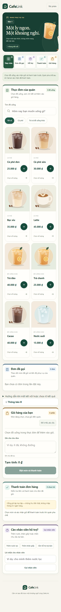
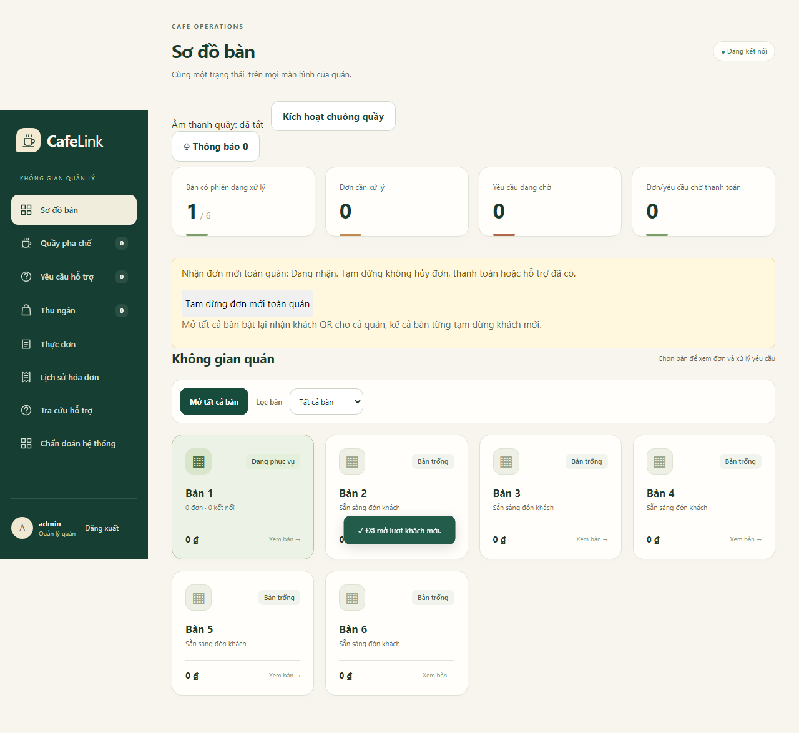
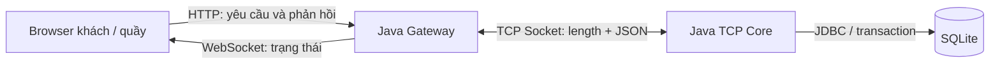

# CafeLink

**Hệ thống gọi món QR và điều phối phục vụ tại quán café theo mô hình Client/Server.** Bài tập lớn môn Lập trình mạng, Topic 3 - Ứng dụng mạng và hệ thống phân tán.

Khách quét QR tại bàn để xem món, đặt hàng, thanh toán giả lập và theo dõi phục vụ. Quầy quản lý thực đơn, nhận đơn, điều phối pha chế/giao đồ và xử lý hỗ trợ. Nhiều khách cùng bàn dùng chung QR nhưng có phiên, giỏ và đơn riêng.

**Source:** V9.4, schema 11. **Báo cáo hiện tại:** [Word](report/NhomXX_CafeLink_Report_Current_20261030.docx) · [PDF, 41 trang](report/NhomXX_CafeLink_Report_Current_20261030.pdf). Thanh toán dùng `LOCAL_SIMULATOR`, không thu tiền thật.

| Bắt đầu tại đây | Nội dung |
|---|---|
| [Chạy nhanh](#chạy-nhanh-trên-windows) | Build source, mở quản lý và vào bàn |
| [Hướng dẫn build/run/test](cafelink-system/README.md) | Môi trường, cấu hình, dữ liệu và các lệnh |
| [Kịch bản demo](cafelink-system/docs/FINAL_RUNBOOK.md) | Local, public HTTPS, nhiều khách và lỗi thường gặp |
| [Chỉ mục kỹ thuật](cafelink-system/docs/README.md) | Kiến trúc, giao thức, kiểm thử, phục hồi và vận hành |
| [Báo cáo và kết quả](report/README.md) | Bản mới, số đo, bằng chứng và hồ sơ lịch sử |

## Chạy nhanh trên Windows

Máy chủ cần **PowerShell 5.1+, JDK 17+, Node.js 22.12+ và npm**. Cần Internet cho lần build đầu; không cần cài Maven hoặc database server riêng. Client chỉ cần trình duyệt.

```powershell
git clone https://github.com/hieupham03/Cafe-link.git
cd Cafe-link\cafelink-system
powershell -NoProfile -ExecutionPolicy Bypass -File scripts/build-web.ps1
powershell -NoProfile -ExecutionPolicy Bypass -File scripts/run-web.ps1 -Port 8088 -TcpPort 5058 -DatabasePath data/local-demo/cafelink.db
```

1. Giữ terminal mở, vào **http://127.0.0.1:8088/admin**.
2. Đăng nhập local: **`admin` / `CafeLink@123`**.
3. Chọn **Mở tất cả bàn → Bàn 1 → Sao chép link đặt món**.
4. Dán nguyên link vào browser/profile khác để làm khách. Hai khách độc lập cần hai profile, trình duyệt hoặc thiết bị độc lập.
5. Chọn món → gửi đơn → thanh toán thử thành công. Quầy chuyển pha chế → sẵn sàng → giao đủ; khách nhận cập nhật trực tiếp.

SQLite tự tạo schema, tài khoản demo, sáu bàn và tám món khi dùng DB mới. Dữ liệu cũ được giữ khi chạy lại. Nhấn **Ctrl+C** tại terminal Server để dừng. [Runbook](cafelink-system/docs/FINAL_RUNBOOK.md) giải thích trường hợp chỉ mở `/join` hoặc dùng chung cookie quản lý/khách.

### Cho điện thoại quét QR qua Internet

Dừng local, rồi chạy từ `cafelink-system` sau khi build:

```powershell
powershell -NoProfile -ExecutionPolicy Bypass -File scripts/public-demo.ps1 -SkipBuild -Port 19088 -TcpPort 19058 -DurationSeconds 1800
```

Dùng **URL HTTPS và mật khẩu tạm mà terminal in ra**, mở tất cả bàn rồi lấy QR. Điện thoại có thể dùng Wi-Fi hoặc dữ liệu di động; máy chủ phải tiếp tục chạy và có Internet. Local/public dùng DB riêng. Tunnel đổi địa chỉ thì lấy QR mới. [Chi tiết public demo](cafelink-system/docs/WEB_PUBLIC_DEMO.md).

## Chức năng chính

| Người sử dụng | Chức năng |
|---|---|
| Khách | QR, thực đơn có ảnh, giỏ/số lượng/ghi chú, đặt món, thanh toán giả lập, tiến độ đơn, gọi/bổ sung/rút hỗ trợ |
| Quản lý/quầy | Menu/ảnh, nhận hoặc tạm dừng đơn mới, pha chế/giao, thông báo, hỗ trợ, lịch sử và chẩn đoán |
| Hệ thống | Xác thực và phiên riêng, kiểm giá/quyền/trạng thái tại Server, chống áp lại cùng yêu cầu, phục hồi và cập nhật trực tiếp |

<table>
  <tr>
    <td width="32%"><br>Giao diện khách</td>
    <td width="68%"><br>Màn quản lý</td>
  </tr>
</table>

Ảnh từ ca kiểm Chromium V9.4, minh họa giao diện; không phải ảnh vận hành tại quán.

## Kiến trúc và nội dung Lập trình mạng



`WebMain` khởi động Gateway và Core trong cùng tiến trình Java, nhưng hai thành phần trao đổi qua **socket TCP loopback thật**. Gateway là Server đối với Browser, đồng thời dùng `NetworkClient` làm TCP Client của Core. Browser không mở raw TCP hoặc ghi thẳng SQLite.

| Nội dung môn học | Cách triển khai |
|---|---|
| TCP và giao thức ứng dụng | Header độ dài 4 byte big-endian + JSON UTF-8; đọc đủ header/body, kiểm frame sai |
| Request/response | `requestId` ghép phản hồi; giữ mã khi thử lại cùng thao tác |
| Nhiều Client | Reader pool, writer/hàng đợi từng kết nối; khóa ghi frame và đồng bộ trạng thái |
| Server push | Core gửi qua TCP; Gateway chuyển snapshot theo quyền tới Browser bằng WebSocket |
| Xử lý lỗi | Timeout, disconnect, Client chậm, rollback, đối chiếu kết quả và bảo vệ phiên |

[Kiến trúc](cafelink-system/docs/FINAL_ARCHITECTURE.md) · [Giao thức và ví dụ bản tin](cafelink-system/docs/FINAL_PROTOCOL.md).

## Công nghệ

Java target 17, Maven bootstrap, Jetty HTTP/WebSocket, Gson, SQLite JDBC; React/TypeScript/Vite và IndexedDB ở Browser; JUnit, Playwright và Python cho kiểm thử/thực nghiệm. [Phiên bản và lý do dùng thư viện](cafelink-system/README.md#công-nghệ-và-thư-viện) được đối chiếu với manifest của source.

## Kiểm thử và kết quả thực nghiệm

Chạy tại `cafelink-system`:

```powershell
powershell -NoProfile -ExecutionPolicy Bypass -File scripts/test-web.ps1 -Phase V9.4
```

Kiểm cuối RC4: **164 Java, 71 Chromium, 20 Firefox, 20 WebKit, 23 nhóm kiểm gói và 8 kiểm public**. Các lớp kiểm có phạm vi riêng, không cộng thành tỷ lệ bao phủ. Nhóm đã xác nhận hoàn thành kiểm thao tác thực tế; số đo hiệu năng đến từ bộ thực nghiệm riêng. [Phạm vi kiểm và lệnh chạy](cafelink-system/docs/TESTING.md).

| Thực nghiệm V9.4/RC3 ngày 30/10 | Kết quả |
|---|---|
| Phục hồi: 8 kịch bản × 3 chính sách × 5 lần | 120 ca; lời gọi ngoài nhu cầu quy định của R0/R1/R2: **10/5/0** |
| Tải: 1/5/10/14 khách giả lập, 3 lượt mỗi mức | **1.256/1.350** lượt hoàn tất; **94 lượt chưa phát**, đều ở mức 14 khách |
| Các thao tác đã phát | 0 lỗi flow/HTTP đã ghi; p95 đặt món ở mức 14 khách: **674,6-733,7 ms** |

Các thành phần cùng chạy trên một máy qua loopback. Lượt chưa phát khác với đơn đã nhận bị mất; đây chưa phải công suất tối đa. Số đo RC3 không được gọi là benchmark RC4. [Phương pháp và raw](cafelink-system/docs/WEB_EXPERIMENTS.md) · [Phiếu kiểm RC4](report/evidence/cafelink-v2/pre-feature-20261030/final-verification.json).

## Đóng góp kỹ thuật

- **Phục hồi theo loại yêu cầu:** tra kết quả Server trước; đơn chưa nhận chờ khách quyết định, lời gọi ngắn hạn cũ được bỏ theo chính sách.
- **Lưu quyết định bỏ theo phiên:** bỏ trước thì chặn lệnh đến muộn; nhận trước thì giữ kết quả đã nhận. Yêu cầu cũ không tự chuyển sang khách mới.

Các phương án đối chứng giữ chung chống trùng và kiểm quyền/phiên. Đóng góp là cách tích hợp và đánh giá trong CafeLink, không tuyên bố TCP, QR hoặc idempotency là kỹ thuật mới. [Cơ chế và ví dụ](cafelink-system/docs/WEB_RECOVERY.md).

## Cấu trúc repository

```text
Cafe-link/
├── README.md                Tổng quan và đường vào dự án
├── cafelink-system/         Source Java/web, test, script, tài liệu kỹ thuật
├── report/                  Báo cáo Word/PDF, hình và evidence theo từng mốc
├── dist/                    Baseline E0 niêm phong phục vụ test/CI
├── final-project-2/         Bộ yêu cầu học phần hiện hành
├── final-project/           Đường dẫn tương thích của hồ sơ cũ
└── .github/workflows/       CI Windows
```

Giữ cấu trúc source để script, test và raw tiếp tục truy vết được. Gói portable RC4 và dữ liệu demo giữ ngoài Git; khi clone repo dùng quy trình build phía trên. [README dist](dist/README.md) giải thích ZIP E0, không dùng ZIP đó thay source web mới.

## Giới hạn và hướng mở rộng

Thanh toán/hoàn tiền giả lập; chưa có ngân hàng, kho nguyên liệu hoặc nhiều chi nhánh. QR có thể được chia sẻ; phục hồi phụ thuộc quyền và dữ liệu Browser còn giữ. Mức tải đã thử và giới hạn cấu hình không phải SLA. Hướng tiếp theo là đo từng thành phần để tối ưu đúng nơi, dùng địa chỉ web ổn định và tích hợp đối soát nếu dùng tiền thật.

## Nhóm thực hiện

Giảng viên hướng dẫn: **Ngô Văn Quyền**. Thành viên theo báo cáo đã chỉnh sửa:

| Thành viên | MSSV |
|---|---|
| Phạm Chí Hiếu | B23DCCN309 |
| Nguyễn Đình Quang Huy | B23DCCN393 |
| Trương Khánh Hợp | B23DCCN351 |

## Tài liệu và yêu cầu nộp

Ưu tiên [Instruction](final-project-2/final-project/Instruction.md), [Topics](final-project-2/final-project/Topics.md) và [Submission](final-project-2/final-project/Submission.md). README/SPECIFICATION trong bộ môn là mẫu; [đặc tả CafeLink](cafelink-system/docs/PROJECT_SPECIFICATION.md) áp dụng riêng cho sản phẩm.

Trước bàn giao, tổ chức `Source/` và `Report/`, dùng tên `NhomXX_CafeLink_Report.docx` với số nhóm thật và hoàn tất Compilatio theo quy định. GitHub không thay bước nộp chính thức. [Chỉ mục báo cáo](report/README.md) phân biệt bản hiện tại với mốc lịch sử.

Nguồn kỹ thuật: [RFC 9293 - TCP](https://www.rfc-editor.org/rfc/rfc9293.html), [RFC 6455 - WebSocket](https://www.rfc-editor.org/rfc/rfc6455.html), [RFC 9110 - HTTP](https://www.rfc-editor.org/rfc/rfc9110.html), [SQLite transactions](https://www.sqlite.org/lang_transaction.html), [IndexedDB](https://www.w3.org/TR/IndexedDB/).
