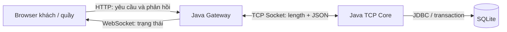

# CafeLink

**Hệ thống gọi món QR và điều phối phục vụ tại quán cà phê theo mô hình Client/Server.** Bài tập lớn môn Lập trình mạng, Topic 3 - Ứng dụng mạng và hệ thống phân tán.

Khách quét QR tại bàn, chọn món, gửi đơn và chờ quầy tiếp nhận trước khi thanh toán giả lập. Quầy kiểm tra khả năng phục vụ, pha chế, giao đồ và xử lý yêu cầu hỗ trợ. Nhiều khách cùng bàn dùng chung QR nhưng có phiên, giỏ và đơn riêng. Quản lý cấu hình thực đơn, thuế, thu chi và tài khoản nhân viên.

Phiên bản ứng dụng **V10.1**, SQLite **schema 13**. Hình thức chạy là build từ source trên Windows; Client sử dụng trình duyệt. Thanh toán và hoàn tiền dùng `LOCAL_SIMULATOR`, không chuyển tiền thật.

| Tài liệu | Nội dung |
|---|---|
| [README source](cafelink-system/README.md) | Môi trường, build, cấu hình, chạy và kiểm thử |
| [Hướng dẫn sử dụng](cafelink-system/docs/USER_GUIDE.md) | Khách, quầy, quản lý và các quy tắc nghiệp vụ |
| [Chạy và demo](cafelink-system/docs/RUNBOOK.md) | Chuẩn bị, hai kịch bản demo và xử lý lỗi |
| [Chỉ mục kỹ thuật](cafelink-system/docs/README.md) | Kiến trúc, giao thức, quyền, dữ liệu và vận hành |

## Chạy nhanh trên Windows

Máy chủ cần **PowerShell 5.1+, JDK 17+, Node.js 22.12+ và npm**. Internet cần cho lần tải dependency đầu tiên. Maven được script bootstrap; SQLite là CSDL nhúng, không cần cài database server.

```powershell
git clone https://github.com/hieupham03/Cafe-link.git
cd Cafe-link\cafelink-system
powershell -NoProfile -ExecutionPolicy Bypass -File scripts/build-web.ps1
powershell -NoProfile -ExecutionPolicy Bypass -File scripts/run-web.ps1 -Port 8088 -TcpPort 5058 -DatabasePath data/local-demo/cafelink.db
```

1. Giữ terminal mở, truy cập **http://127.0.0.1:8088/admin**.
2. Đăng nhập local bằng **`admin` / `CafeLink@123`**.
3. Chọn **Mở tất cả bàn** để bật nhận khách và hiển thị QR trên từng thẻ bàn.
4. Mở **Bàn 1 → Sao chép link đặt món**, dán nguyên link vào trình duyệt/profile khác để làm khách.
5. Khách chọn món → gửi đơn. Quầy tiếp nhận → khách thanh toán giả lập → quầy pha chế, chuyển sẵn sàng và giao đồ.

Đăng nhập quản lý tạm ngưng nhận khách QR mới; các phiên đang có vẫn được giữ. Thanh toán/giao món xong không tự kết thúc phiên vì khách có thể gọi tiếp. Khách chọn **Rời phiên** khi đã hết công việc; quản lý có thể kết thúc phiên bị bỏ quên sau khi xử lý hết đơn và hỗ trợ.

DB mới tự tạo sáu bàn, tám món có ảnh và tài khoản quản lý. Chạy lại cùng đường dẫn giữ dữ liệu. **Ctrl+C** dừng Server. Hai khách độc lập cần hai thiết bị, trình duyệt hoặc profile khác nhau; hai tab cùng profile có thể dùng chung cookie.

### Điện thoại truy cập qua Internet

Sau khi build, chạy từ `cafelink-system` với cặp cổng trống:

```powershell
powershell -NoProfile -ExecutionPolicy Bypass -File scripts/public-demo.ps1 -SkipBuild -Port 19088 -TcpPort 19058 -DurationSeconds 1800
```

Dùng **URL HTTPS và mật khẩu quản lý tạm do terminal in ra**, mở các bàn rồi lấy QR. Điện thoại có thể dùng Wi-Fi hoặc dữ liệu di động; máy chủ và tunnel phải tiếp tục chạy. Local/public dùng DB riêng. Khi tunnel đổi địa chỉ, lấy QR của lần chạy hiện tại. [Hướng dẫn public](cafelink-system/docs/PUBLIC_DEMO.md).

## Chức năng

| Vai trò | Chức năng |
|---|---|
| Khách | Thực đơn có ảnh, giỏ/số lượng/ghi chú, chờ tiếp nhận, thanh toán giả lập, tiến độ đơn, gọi/bổ sung/rút hỗ trợ, rời phiên |
| Nhân viên - STAFF | Xem bàn/QR, tiếp nhận hoặc từ chối đơn chưa trả, pha chế/giao đồ, hỗ trợ, thông báo và đánh dấu hết/còn món |
| Quản lý - ADMIN | Toàn bộ phục vụ; menu/ảnh/giá, thuế, thu chi, lịch sử hóa đơn, hoàn giả lập, tài khoản nhân viên, chẩn đoán và quản lý nhận khách/phiên |
| Hệ thống | Kiểm quyền/giá/trạng thái tại Server, lưu bền, chống áp lại cùng lệnh, phục hồi kết quả chưa rõ và cập nhật trực tiếp |

**Tạm ngưng tất cả bàn** chặn khách QR mới, giữ các phiên hiện tại. **Kết thúc tất cả phiên QR** chỉ thành công khi mọi phiên đã hết đơn/hỗ trợ cần xử lý; nếu còn việc, hệ thống liệt kê bàn bị chặn và không đóng một phần. Hai thao tác cần quyền ADMIN và xác nhận. [Bảng quyền](cafelink-system/docs/ACCESS_CONTROL.md).

## Giao diện

Ảnh dùng dữ liệu minh họa. Màn hình di động được chụp bằng viewport trình duyệt; QR trong ảnh không dùng thay QR của Server đang chạy.


<table>
  <tr><th width="50%">Khách chọn món</th><th width="50%">Đơn chờ tiếp nhận</th></tr>
  <tr>
    <td align="center"></td>
    <td align="center"></td>
  </tr>
</table>


<table>
  <tr><th width="50%">Quầy tiếp nhận và pha chế</th><th width="50%">Thu chi</th></tr>
  <tr>
    <td></td>
    <td></td>
  </tr>
</table>

<details>
<summary>Đăng nhập, cấu hình thuế và nhân viên</summary>


</details>

## Kiến trúc và nội dung Lập trình mạng



`WebMain` tạo Gateway và Core trong cùng tiến trình Java. Hai thành phần trao đổi qua **socket TCP loopback**: Gateway là web Server của Browser và là TCP Client của Core. Core kiểm nghiệp vụ và ghi SQLite; Browser không mở raw TCP hoặc ghi DB trực tiếp.

| Nội dung môn học | Triển khai |
|---|---|
| TCP và framing | Header độ dài 4 byte big-endian + JSON UTF-8; đọc đủ header/body, kiểm frame sai |
| Request/response/event | Ghép phản hồi bằng `requestId`; Server phát cập nhật chủ động |
| Nhiều Client | Reader pool, writer/hàng đợi từng peer, khóa ghi frame và đồng bộ nghiệp vụ |
| Lỗi kết nối | Timeout, reconnect, receipt, transaction và đối chiếu kết quả |
| Quyền và dữ liệu | Xác thực, scope phiên, giá/version và snapshot theo quyền |

[Kiến trúc](cafelink-system/docs/ARCHITECTURE.md) · [Giao thức và ví dụ bản tin](cafelink-system/docs/PROTOCOL.md).

## Phục hồi yêu cầu

Browser lưu ý định trước khi gửi. Nếu mất phản hồi, Client hỏi Server bằng mã gốc: đã nhận thì lấy lại kết quả; đơn chưa nhận cần khách quyết định, lời gọi hỗ trợ ngắn hạn chưa nhận được xử lý theo chính sách ngữ nghĩa. Quyết định bỏ được lưu tại Core để chặn lệnh cũ đến muộn; nếu lệnh được nhận trước, hệ thống giữ kết quả đã có.

Đóng góp là cách tích hợp và đánh giá phục hồi theo loại yêu cầu và phạm vi phiên trong CafeLink. Các phương án đối chứng cùng giữ chống trùng và kiểm quyền. [Cơ chế phục hồi](cafelink-system/docs/RECOVERY.md) · [Phương pháp thực nghiệm](cafelink-system/docs/EXPERIMENTS.md).

## Kiểm thử

Chạy tại `cafelink-system`:

```powershell
powershell -NoProfile -ExecutionPolicy Bypass -File scripts/test-web.ps1 -Phase V10.1
```

Bộ kiểm gồm Java unit/integration, giao thức TCP, HTTP/WebSocket, nghiệp vụ và Chromium E2E. Cổng fixture **18080/18081** cần trống. Có kiểm Firefox/WebKit riêng, kiểm công bố tài liệu và harness phục hồi/tải. [Lệnh và tiêu chí kiểm](cafelink-system/docs/TESTING.md) · [CI](cafelink-system/docs/CI.md) · [GitHub Actions](https://github.com/hieupham03/Cafe-link/actions).

Kết quả thuộc từng lần chạy và commit; xem artifact của lượt tương ứng. Test engine/viewport không thay phép kiểm điện thoại, camera hoặc mạng vật lý.

## Công nghệ và cấu trúc

Java target 17, Jetty HTTP/WebSocket, Gson, SQLite JDBC; React/TypeScript/Vite, IndexedDB; JUnit, Playwright và Python. Dependency được ghim trong manifest/lockfile. [Chi tiết source](cafelink-system/README.md#công-nghệ).

```text
Cafe-link/
├── README.md
├── cafelink-system/     Java/web, test, script, tài liệu kỹ thuật
├── report/              Hướng dẫn hồ sơ báo cáo học phần
├── dist/                Fixture đối chứng niêm phong cho kiểm thử
└── .github/workflows/   CI Windows
```

## Phạm vi

Sản phẩm dành cho một quán, thanh toán/hoàn giả lập. Không tích hợp ngân hàng, kho nguyên liệu, giao từng phần hoặc nhiều chi nhánh. QR có thể được chia sẻ; phục hồi phụ thuộc quyền và dữ liệu Browser còn giữ. Giới hạn tài nguyên là cấu hình bảo vệ, không phải công suất phục vụ đã đo. Quick Tunnel phù hợp demo; triển khai lâu dài cần địa chỉ HTTPS ổn định.

## Nhóm thực hiện

Nhóm 11. Giảng viên hướng dẫn: **Ngô Văn Quyền**.

| Thành viên | MSSV |
|---|---|
| Phạm Chí Hiếu | B23DCCN309 |
| Nguyễn Đình Quang Huy | B23DCCN393 |
| Trương Khánh Hợp | B23DCCN351 |

[Đặc tả dự án](cafelink-system/docs/PROJECT_SPECIFICATION.md) · [Hồ sơ báo cáo](report/README.md).
