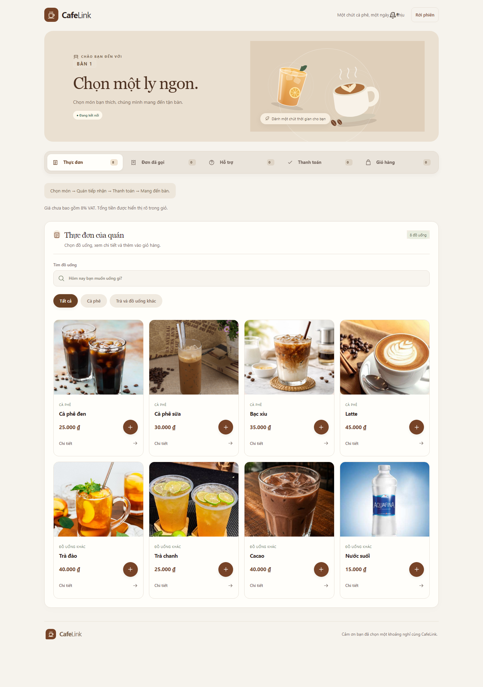
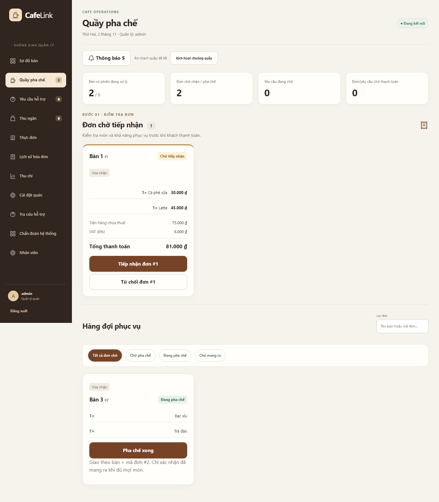

# CafeLink - Hướng dẫn source

Source hiện hành **V10.1 / schema 13**; xem [nguồn đóng góp](../CONTRIBUTIONS.md). [V10.1](docs/UPGRADE_V10_1_ROLES.md) mô tả phân quyền ADMIN/STAFF và quản lý tài khoản. [V10](docs/UPGRADE_V10.md) mô tả tiếp nhận trước thanh toán, QR trên thẻ bàn, thu chi và thuế. Gói **V9.4/RC4** và báo cáo đã chốt là mốc trước nâng cấp; chạy V10.1 từ source theo hướng dẫn dưới.

## Mục lục

- [Yêu cầu môi trường](#yêu-cầu-môi-trường)
- [Cài đặt và build](#cài-đặt-và-build)
- [Chạy Server và Client](#chạy-server-và-client)
- [Giao diện hiện hành](#giao-diện-hiện-hành)
- [Cấu hình và dữ liệu](#cấu-hình-và-dữ-liệu)
- [Demo public HTTPS](#demo-public-https)
- [Kiểm thử](#kiểm-thử)
- [Thực nghiệm](#thực-nghiệm)
- [Đóng gói](#đóng-gói)
- [Kiến trúc và source](#kiến-trúc-và-source)
- [Công nghệ và thư viện](#công-nghệ-và-thư-viện)
- [Tài liệu và giới hạn](#tài-liệu-và-giới-hạn)

## Yêu cầu môi trường

| Mục đích | Phần mềm |
|---|---|
| Build source trên Windows x64 | PowerShell 5.1+, JDK 17+ có `java`/`javac`, Node.js 22.12+ và npm |
| Kiểm Java và Browser | Môi trường build; Playwright tự tải Chromium trong script test |
| Thực nghiệm, kiểm toàn workflow | Python 3.13; `tools/requirements-v8.txt` |
| Chạy gói portable được cấp riêng | Windows x64; JRE có sẵn trong gói, không cần JDK/Node |
| Khách/quầy | Trình duyệt; điện thoại dùng URL HTTPS khi demo public |

Node cũng chấp nhận nhánh 20 từ 20.19 theo `web/package.json`; các lệnh Windows và CI dùng Node 22. Maven bootstrap trong script nên không cần cài Maven riêng. Lần build đầu cần Internet tải dependency. Linux/macOS chưa có runbook tương đương đã nghiệm thu.

Kiểm công cụ trước khi build:

```powershell
java -version
javac -version
node --version
npm.cmd --version
```

## Cài đặt và build

Clone tại một thư mục của bạn, rồi chạy:

```powershell
git clone https://github.com/hieupham03/Cafe-link.git
cd Cafe-link\cafelink-system
powershell -NoProfile -ExecutionPolicy Bypass -File scripts/build-web.ps1
```

Nếu đã clone, mở PowerShell tại **`cafelink-system/`**. Tất cả lệnh còn lại trong README dùng thư mục này, trừ khi ghi khác.

Build dùng `npm ci`, typecheck/build frontend và Maven package Java. Output:

```text
target/cafelink-1.0.0.jar     Java Gateway/Core
target/lib/                 Dependency Java
web/dist/                   Website production
```

Tên Maven artifact `1.0.0` giữ để tương thích script; bản ứng dụng local hiện là V10.1. Build không thay thế kiểm thử đầy đủ. Sau khi code hoặc lockfile đổi, build lại; `-SkipInstall` chỉ dùng khi npm dependencies đã khớp lock.

## Chạy Server và Client

### Khởi động Server

```powershell
powershell -NoProfile -ExecutionPolicy Bypass -File scripts/run-web.ps1 -Port 8088 -TcpPort 5058 -DatabasePath data/local-demo/cafelink.db
```

Terminal in URL và cổng Core; giữ terminal mở. `WebMain` khởi động Gateway và Core trong cùng tiến trình, kết nối bằng TCP loopback thật. Nhấn **Ctrl+C** để dừng.

### Mở Client quản lý và khách

1. Quản lý vào **http://127.0.0.1:8088/admin**, đăng nhập **`admin` / `CafeLink@123`**.
2. Chọn **Mở tất cả bàn** để hiện QR ngay trên từng thẻ. Có thể vào **Bàn 1**, lấy **Sao chép link đặt món**.
3. Khách dùng browser/profile khác mở nguyên link. Link có mã bàn trong fragment `#table=...`; trang chỉ có `/join` không đủ thông tin.
4. Khách gửi đơn; quầy chọn **Quầy pha chế → Tiếp nhận đơn** hoặc từ chối kèm lý do. Chỉ sau tiếp nhận, khách mới được thanh toán giả lập. Quầy pha chế rồi giao.
5. Mở thêm một Client độc lập cùng QR để kiểm hai khách cùng bàn có đơn riêng.

Không cần chạy thêm app Java phía khách. Tab thường dùng chung cookie; các cửa sổ ẩn danh cùng mở cũng có thể dùng chung phiên riêng tư. Hai khách độc lập nên dùng hai browser/profile/thiết bị khác nhau.

## Giao diện hiện hành

Ảnh chụp source V10.1 ngày 02/11/2026 với dữ liệu minh họa riêng. [Thư viện ảnh ở README chính](../README.md#giao-diện-hiện-hành) có cả màn khách trên máy tính/di động, QR bàn, quầy, thu chi, thuế và tài khoản nhân viên.

| Khách chọn món | Quầy tiếp nhận và pha chế |
|---|---|
|  |  |

## Cấu hình và dữ liệu

### Tham số chạy

| Tham số `run-web.ps1` | Mặc định của script | Ý nghĩa |
|---|---|---|
| `-Port` | `8080` | HTTP/WebSocket của Gateway; ví dụ README chọn 8088 |
| `-TcpPort` | `5051` | TCP Core; ví dụ README chọn 5058 |
| `-DatabasePath` | `data/v2/cafelink.db` | File SQLite; dùng profile riêng theo mục đích |
| `-BindAddress` | `127.0.0.1` | HTTP phát triển chỉ trên loopback; LAN trực tiếp cần TLS |
| `-OrderingMode` | `prepay` | Luồng QR trả trước; `postpay` giữ cho tương thích |
| `-AssetsPath` | `web/dist` | Thư mục website production |
| `-QrKeyFile` | File cạnh DB khi không chỉ định | Khóa ký quyền QR |
| `-PublicOrigin`, `-TrustedProxy` | Không bật | Public HTTPS qua proxy; dùng launcher public để cấu hình đồng bộ |
| `-KeyStore` | Không bật | Keystore cho TLS trực tiếp; đọc mật khẩu từ biến môi trường |

Các đường dẫn dữ liệu tương đối được giải theo project `cafelink-system`. Luồng web hiện tại không tự đọc file `.env`. `CAFELINK_KEYSTORE_PASSWORD` dùng khi cấu hình TLS; `CAFELINK_QR_KEY` là lựa chọn cấp khóa từ môi trường. Public launcher tự cấu hình mật khẩu demo tạm, không cần điền secret để chạy Quick Tunnel.

### Khởi tạo và giữ dữ liệu

SQLite tự tạo/migrate schema 13, tài khoản demo, sáu bàn và tám món khi mở DB mới; không cần cài database server hoặc nhập SQL. Seed không reset DB cũ. Để nghiệm thu V10.1 lần đầu, dùng DB riêng như `data/v10-roles-review/cafelink.db`.

Profile local trong ví dụ chứa DB, khóa QR cạnh DB và thư mục ảnh. Browser giữ cookie và IndexedDB riêng theo origin. Chạy lại cùng profile còn dữ liệu là hành vi lưu bền có chủ đích. Muốn thử sạch, dùng một `DatabasePath` mới và browser/profile khách mới. Không xóa DB đang chạy hoặc chỉ chép file DB khi còn ghi WAL.

[Backup/reset/restore](docs/WEB_RELEASE.md) áp dụng cho gói portable; [runbook](docs/FINAL_RUNBOOK.md) phân biệt dữ liệu Client và Server.

## Demo public HTTPS

Dừng local trước khi đổi chế độ. Sau build:

```powershell
powershell -NoProfile -ExecutionPolicy Bypass -File scripts/public-demo.ps1 -SkipBuild -Port 19088 -TcpPort 19058 -DurationSeconds 1800
```

Script dùng Cloudflare Quick Tunnel đã ghim checksum, tạo profile public và mật khẩu quản lý tạm, in HTTPS để demo. Đăng nhập bằng mật khẩu vừa in; mở các bàn rồi lấy QR mới. Điện thoại không cần chung Wi-Fi với máy chủ.

Máy chủ phải bật và có Internet. Tunnel đổi hostname khi chạy lại; cookie/IndexedDB ở hostname cũ không tự chuyển sang hostname mới. Core vẫn loopback, không mở cổng TCP ra Internet. Xem [public demo](docs/WEB_PUBLIC_DEMO.md) hoặc [LAN có TLS](docs/LAN_ACCEPTANCE.md). Cổng bận thì chọn cặp trống; launcher không tự dừng tiến trình đang chiếm cổng.

## Kiểm thử

Bản tích hợp V10.1 đã chạy 201 Java, 90 Chromium và 8 ca phân quyền trên mỗi engine Chromium/Firefox/WebKit, đều đạt. Chỉnh CSS cuối có lượt kiểm lại riêng và bộ 17 ảnh. [Chi tiết nghiệm thu V10.1](docs/UPGRADE_V10_1_ROLES.md#kết-quả-kiểm) ghi phạm vi, bằng chứng và giới hạn; kiểm engine chưa thay kiểm điện thoại vật lý.

Trước push hoặc đóng gói, xem [kiểm nội dung công bố](docs/PUBLICATION.md). CI dùng chung policy với script đóng gói để chặn hướng dẫn phiên bản cũ, liên kết hỏng và các cặp báo cáo bị trộn.

| Lệnh | Phạm vi |
|---|---|
| `powershell -NoProfile -ExecutionPolicy Bypass -File scripts/maven.ps1 -B test` | Java: protocol, TCP, service, DB, Gateway và hồi quy desktop |
| `powershell -NoProfile -ExecutionPolicy Bypass -File scripts/test-web.ps1 -Phase V10.1` | Java verify + build production/experiment + Chromium E2E, gồm phân quyền/thu hồi phiên/tiếp nhận/thuế/thu chi |
| `powershell -NoProfile -ExecutionPolicy Bypass -File scripts/test-browser-compatibility.ps1` | Các nhóm chọn lọc trên Firefox và WebKit |
| `powershell -NoProfile -ExecutionPolicy Bypass -File scripts/test-v8.ps1 -Quick` | Bộ workflow: cấu hình, guard, test Java/web, analyzer và campaign ngắn |

Lệnh `test-v8.ps1` là bộ nghiệm thu/phát hành của mốc V9.4. Dùng `test-web.ps1 -Phase V10.1` cho nâng cấp hiện tại; [V10.1](docs/UPGRADE_V10_1_ROLES.md) ghi phạm vi và kết quả đã chạy. Kiểm Firefox/WebKit mới cũng được phân biệt với kết quả RC4 bên dưới.

Cổng test **18080/18081** phải trống. Script tạo DB và tiến trình riêng, không dùng lại demo của bạn. Evidence mới nằm trong `../report/evidence/cafelink-v2/v9.4-gate/<run>/`; các bản đã chốt được giữ riêng. Chỉ thêm `-SkipInstall -SkipBrowserInstall` khi dependencies/browser đã có.

Kiểm cuối RC4 đã ghi nhận **164 Java, 71 Chromium, 20 Firefox, 20 WebKit, 23 nhóm kiểm gói và 8 kiểm public**. [TESTING](docs/TESTING.md) nối kết quả với nhóm hành vi và nguồn bằng chứng; [CI](docs/CI.md) ghi đúng commit/run đã kiểm. Test engine trên Windows và xác nhận thao tác thực tế được phân biệt với số đo hiệu năng.

## Thực nghiệm

Sau build/kiểm hồi quy, cài dependency và chọn thư mục kết quả mới:

```powershell
python -m pip install -r tools/requirements-v8.txt
powershell -NoProfile -ExecutionPolicy Bypass -File scripts/experiment-web.ps1 -OutputPath ..\report\evidence\cafelink-runs\my-new-run
```

Chạy lại với tên output khác; script từ chối ghi đè thư mục đã có dữ liệu. Full campaign gồm 120 ca phục hồi và 12 lượt tải, warmup 3 giây/đo 15 giây, các mức 1/5/10/14 khách. Có thể dùng `-Quick` cho lượt kiểm ngắn.

R0 gửi lại, R1 chờ xem xét, R2 xử lý theo loại yêu cầu. Các phương án cùng giữ chống trùng và quyền/phiên. Sản phẩm dùng R2; harness không phục vụ trong website production. [Phương pháp, metric và dữ liệu](docs/WEB_EXPERIMENTS.md) giải thích timer, mẫu số, slot chưa phát và oracle.

Số đo gần nhất thuộc **V9.4/RC3 ngày 30/10**: 120 ca phục hồi; tải hoàn tất **1.256/1.350** lượt, **94 lượt chưa phát** ở 14 khách, không ghi lỗi flow/HTTP đã gửi. Đây là đo cùng máy qua loopback; không gán kết quả đó cho RC4 hoặc coi giới hạn cấu hình là công suất tối đa.

## Đóng gói

Bản hiện hành chạy từ source theo README. Portable V10.1 chưa phát hành; `release/documentation.json` ghi `NOT_RELEASED` và script chặn tạo gói chưa được nghiệm thu. Các template/công cụ được giữ cho bản phát hành sau. Gói V9.4/RC4 và baseline E0 là mốc lịch sử, không chứa các tính năng mới. [Dữ liệu và phiên bản](docs/WEB_RELEASE.md).

## Kiến trúc và source

```text
Browser -- HTTP/WS --> WebGateway / SessionBridge
                            |
                    NetworkClient: TCP
                            |
                       CafeServer
                            |
                       CafeService
                            |
                    SQLite transaction
```

```text
src/main/java/com/cafelink/
  common/        FrameCodec, Message, model và lệnh
  client/        NetworkClient; desktop cũ cho hồi quy
  server/        TCP, xác thực, nghiệp vụ và SQLite
  web/           HTTP/WebSocket, phiên web và chẩn đoán
src/test/        Java tests
web/src/         Giao diện khách/quầy và nhật ký
web/tests/       Browser E2E, kiểm portable/public
web/experiments/ Phục hồi có kiểm soát và phát tải
scripts/         Build, chạy, test, đo và đóng gói
tools/           Đọc DB, phân tích số đo, kiểm workflow
release/         Launcher, runtime pin và UAT kit
docs/            Tài liệu kỹ thuật
```

Core tách đọc socket, xử lý trạng thái và writer/hàng đợi. `CafeService` đồng bộ quyết định nghiệp vụ; transaction ghi dữ liệu và receipt. `NetworkClient` dùng một reader, `pending/requestId` và khóa ghi để phân biệt phản hồi/sự kiện, tránh xen byte giữa frame. [Kiến trúc](docs/FINAL_ARCHITECTURE.md) và [protocol](docs/FINAL_PROTOCOL.md) có mô tả đầy đủ.

## Công nghệ và thư viện

| Thành phần | Phiên bản ghim | Mục đích |
|---|---|---|
| Java / Maven | Target 17 / bootstrap 3.9.11 | Core, TCP, Gateway, build và dependency |
| Jetty WebSocket | 12.0.40 | HTTP/API và WebSocket phía Browser |
| Gson | 2.11.0 | JSON của bản tin và DTO |
| SQLite JDBC | 3.50.3.0 | Dữ liệu nhúng và transaction |
| SLF4J Simple | 2.0.16 | Logging |
| React / TypeScript / Vite | 19.3.1 / 5.9.3 / 8.3.5 | UI, kiểm kiểu và build |
| qrcode.react | 4.2.0 | Hiển thị QR |
| JUnit / Playwright | 5.11.4 / 1.64.1 | Kiểm Java và Browser |
| Python / Matplotlib | Theo `tools/requirements-v8.txt` | Đối chiếu DB, số liệu và biểu đồ |

Manifest gốc: [pom.xml](pom.xml), [package.json](web/package.json), [lockfile](web/package-lock.json), [requirements](tools/requirements-v8.txt). JDK đo local, target bytecode và JRE trong gói là ba khái niệm riêng.

## Tài liệu và giới hạn

- [Chỉ mục kỹ thuật](docs/README.md): giao thức, kiến trúc, demo, lỗi, thực nghiệm và CI.
- [Báo cáo hiện tại](../report/README.md): Word/PDF mới và dữ liệu theo từng phiên bản.
- [Yêu cầu học phần](../final-project-2/README.md): căn cứ ưu tiên để đối chiếu nội dung.
- [Đặc tả CafeLink](docs/PROJECT_SPECIFICATION.md): phạm vi và điều kiện nghiệp vụ.

Thanh toán/hoàn tiền giả lập, QR có thể chia sẻ và không chứng minh hiện diện. Phục hồi cần quyền/storage còn phù hợp. Chưa có ngân hàng thật, nhiều chi nhánh hoặc công suất tối đa đã chứng minh. Nghiệm thu thao tác thực tế đã được người dùng xác nhận hoàn tất; các phiếu tự động cũ giữ nguyên phạm vi và thời điểm của chúng.
