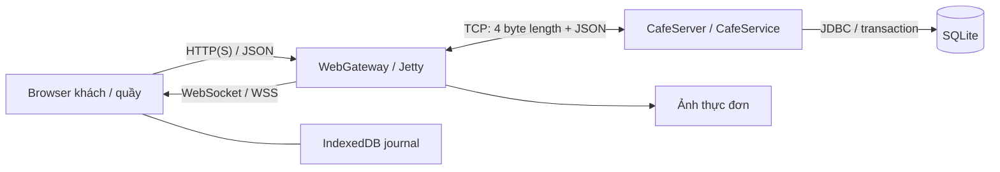
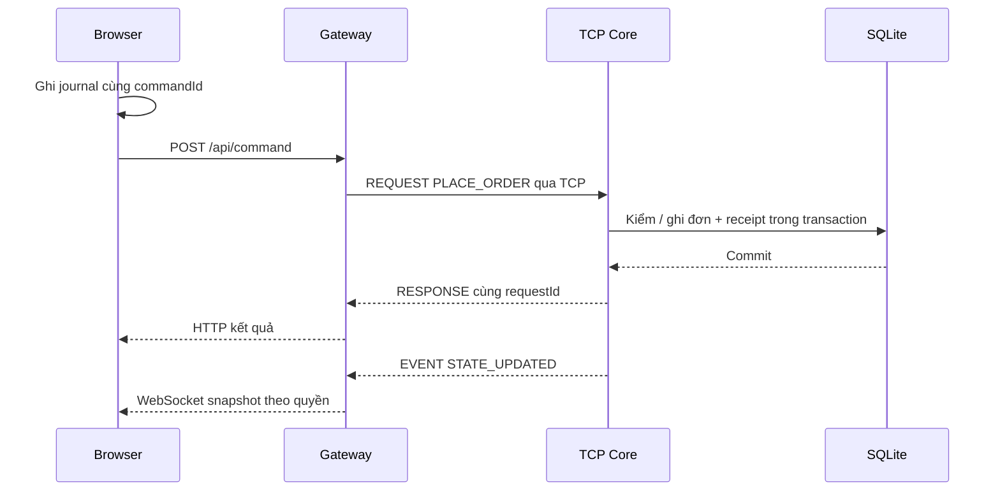

# CafeLink - Kiến trúc hệ thống

CafeLink gồm Browser, Java Web Gateway, Java TCP Core và SQLite. Gateway/Core được `WebMain` khởi tạo trong cùng tiến trình Java nhưng giao tiếp qua socket TCP loopback. Browser sử dụng HTTP/WebSocket, không ghi DB trực tiếp.

## Thành phần và đường truyền

Gateway phục vụ assets/API/ảnh, quản lý cookie, kiểm Origin/CSRF và scope. Mỗi `SessionBridge` giữ `NetworkClient` đã xác thực, dùng chung cho các tab của phiên đó. `CafeServer` đọc frame và điều phối yêu cầu; `CafeService` kiểm danh tính, quyền, giá, phiên và điều kiện chuyển trạng thái rồi ghi transaction.

Core bind `127.0.0.1`. Public demo đặt HTTPS/WSS tunnel trước Gateway, không công khai cổng Core. Upload ảnh đi qua HTTP bytes riêng: Gateway kiểm định dạng, kích thước và re-encode ảnh; metadata món/giá vẫn là lệnh nghiệp vụ qua Core.

## Module

| Module | Trách nhiệm |
|---|---|
| `common` | Message, FrameCodec, model, Commands và Permissions |
| `client/NetworkClient` | Socket, reader duy nhất, pending futures, khóa ghi frame và heartbeat |
| `server/CafeServer` | Acceptor, TCP peers, reader pool, outbound queue và writer |
| `server/CafeService` | Quyết định nghiệp vụ, quyền, receipt và transaction |
| Các service nghiệp vụ | `TableOrdering`, `QrAccess`, `MenuCatalog`, `OrderPayments`, `SupportActions`, `StoreFinance`, `StaffAccounts` |
| `web` | `WebMain`, `WebGateway`, `SessionBridge`, assets, API/WS và chẩn đoán |
| `web/src` | React khách/quầy, kết nối, giỏ, journal và phục hồi |
| `web/experiments`, `tools` | Fault có kiểm soát, tải, DB oracle read-only và analyzer |

## Một lệnh đặt món

Quầy tiếp nhận là bước riêng sau khi Core đã lưu đơn. Khách chỉ bắt đầu trả tiền khi `acceptanceState=ACCEPTED`; pha chế còn yêu cầu trạng thái tiền phù hợp. `PAID` và `SERVED` mô tả hai mặt khác nhau của một đơn.

## Bàn, phiên và danh tính

QR cố định xác định địa chỉ giao đồ. Một Browser/profile mới gia nhập được cấp visit AUTO và membership riêng; token phiên chứng minh quyền, DB lưu hash token. Hai khách cùng bàn không tự có quyền đọc đơn nhau. Hai tab cùng profile có thể chia sẻ cookie, bridge và giỏ.

Phiên AUTO **giữ hoạt động sau khi giao món**, để khách gọi tiếp. Khi không còn đơn/hỗ trợ cần xử lý, khách có thể rời phiên; quản lý có thể kết thúc phiên tại bàn. Đóng tab, mất mạng hoặc hết hạn token không tự chứng minh khách đã rời quán. Lệnh cũ không được chuyển scope sang khách mới.

Quản lý mở/tạm ngưng nhận khách QR độc lập với việc kết thúc phiên. Tạm ngưng giữ nguyên công việc hiện có. Kết thúc hàng loạt kiểm mọi visit AUTO trong một transaction; có việc còn mở thì không đóng một phần. `expectedRevision` phát hiện thay đổi kể từ lúc xác nhận.

ADMIN/STAFF dùng tài khoản. Core kiểm active và `auth_version` cho mỗi yêu cầu; khóa/đặt lại mật khẩu thu hồi quyền của phiên cũ. [Phân quyền](ACCESS_CONTROL.md).

## Đồng thời và tài nguyên

| Cơ chế | Ý nghĩa |
|---|---|
| TCP reader pool tối đa 64 | Giới hạn số peer được đọc đồng thời |
| Queue 64 message/peer, writer riêng | Tách ghi socket khỏi khóa nghiệp vụ; queue đầy thì ngắt peer chậm |
| Một reader trong `NetworkClient` | Ghép RESPONSE vào future theo requestId; EVENT xử lý riêng |
| `writeLock` | Ngăn header/body của hai frame bị ghi xen |
| `synchronized` tại service | Tuần tự hóa quyết định trên trạng thái dùng chung |
| SQLite transaction | Mutation/receipt/event liên quan cùng commit hoặc rollback |
| Gateway bridge/lease | Tối đa 32 bridge; guest tối đa 30, quầy tối đa 16 cùng chia sẻ tổng; bridge đang dùng không bị thu hồi |
| Web Locks + IndexedDB | Tuần tự hóa journal/giỏ trong cùng profile trước gửi |

Snapshot có revision; Client bỏ qua bản cũ hơn. Gateway gộp cập nhật trạng thái khi cần; notification feed/read cursor được lưu riêng. Đọc thông báo không thay việc xử lý đơn hoặc ticket. Các con số giới hạn là cấu hình bảo vệ tài nguyên, không phải công suất đã đo.

## Dữ liệu

SQLite schema 13 lưu thực đơn/version, visit/membership/session, đơn/dòng món/thuế đã chốt, thanh toán/hoàn giả lập, ticket/history, command receipt, notification, phiếu chi và tài khoản/audit. Giá/tên/thuế của đơn không đổi theo menu sau đó.

DB, khóa QR và media thuộc một profile Server. Cookie/IndexedDB thuộc Browser và không nằm trong bản sao lưu Server. [Triển khai và dữ liệu](DEPLOYMENT.md).

## Lựa chọn thiết kế

- Gateway giúp điện thoại dùng web trong khi Core vẫn thực hiện giao tiếp TCP do nhóm định nghĩa.
- TCP cần framing riêng vì cung cấp luồng byte, không có ranh giới JSON.
- Receipt bền giải quyết việc Client chưa biết kết quả sau timeout; retry không được tạo ID mới cho cùng ý định.
- Phục hồi theo loại yêu cầu tránh phát lại nhu cầu hỗ trợ đã cũ; dấu bỏ tại Core xử lý lệnh đến muộn.
- Phiên riêng bảo vệ dữ liệu của nhiều khách cùng QR; quyền luôn được kiểm tại Server.

[Giao thức](PROTOCOL.md) · [Phục hồi](RECOVERY.md) · [Vận hành](OPERATIONS.md).
