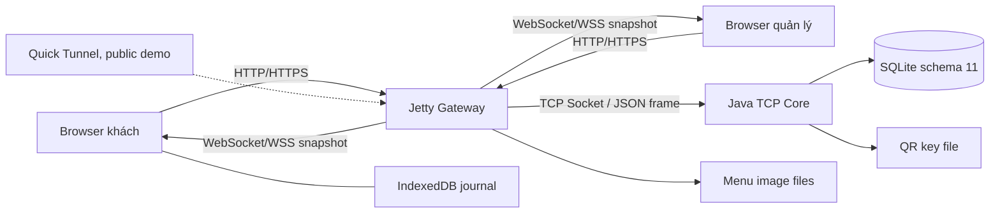

# CafeLink V9.4 - Kiến trúc hệ thống

## 1. Mô hình triển khai

Browser chỉ dùng API web; `SessionBridge` giữ TCP `NetworkClient` tương ứng với identity đã xác thực. Core tập trung luật nghiệp vụ, quyền/scope, transaction và receipt. Gateway không trực tiếp thay DB đơn/ticket/payment. Menu image upload là bytes HTTP, được kiểm/re-encode và lưu file; metadata menu được cập nhật qua Core.

Local dùng HTTP loopback cho demo một máy. Public dùng HTTPS/WSS qua tunnel; Core bind loopback, không expose TCP raw ra Internet. Không coi tunnel thử nghiệm là hạ tầng production.

## 2. Module và trách nhiệm

| Module | Điểm vào/chức năng |
|---|---|
| `common` | `FrameCodec`, `Message`, `Models`, `Commands`: framing, JSON, dữ liệu, phân loại action |
| `server` | `CafeServer`, `CafeService`, `Database`: nhận nhiều TCP peer, xác thực, đồng bộ nghiệp vụ, SQLite |
| Nghiệp vụ chuyên biệt | `TableOrdering`, `MenuCatalog`, `SupportActions`, xử lý payment/continuation/resolution: các guard theo trạng thái |
| `web` | `WebMain`, `WebGateway`, `SessionBridge`: API/WS, cookie, CSRF/Origin, lease bridge, proxy và assets |
| `client` | `NetworkClient`: TCP request/response/event; Swing và công cụ desktop giữ cho hồi quy lịch sử |
| `web/src` | React khách/quầy, `journal`, `orderRecovery`, `staffJournal`, kết nối/recovery và năm vùng UI |
| `web/experiments` + `tools` | Policy driver, fault tầng HTTP, phát tải, oracle SQLite read-only và analyzer |

## 3. Quyền, phiên và trạng thái

Admin dùng tài khoản/mật khẩu. QR cố định là capability nhận khách của bàn; đổi QR thành membership/private visit qua Core rồi Gateway cấp cookie HttpOnly. Nhiều thiết bị cùng bàn có private visit riêng; người có QR không được xem đơn của người khác.

Một visit AUTO gắn đơn/ticket của một chủ thể. Tự hoàn tất khi đã có công việc và mọi nghĩa vụ kết thúc: đơn PAID+SERVED hoặc CANCELLED/REFUNDED theo guard, không còn ticket OPEN. Offline không chứng minh khách đã đi, nên không tự hủy đơn PAID hoặc đóng bàn theo kết nối.

Continuation giữ liên kết để xem đơn trước/chuyển giỏ nháp trong transaction IndexedDB; command đã gửi giữ scope cũ. Dừng khách QR từng bàn khác với dừng đơn mới toàn quán. PAID khác SERVED; receipt thu tiền vẫn được giữ khi hoàn giả lập đơn chưa pha chế.

## 4. Concurrency và giới hạn

- TCP reader pool giới hạn 64; mỗi peer có writer/outbound queue giới hạn 64 message. Socket chậm không được giữ khóa DB trong lúc ghi bytes.
- Service/transaction tuần tự hóa truy cập trạng thái dùng chung. Receipt, thay đổi nghiệp vụ và event tương ứng cùng transaction; lỗi không được ghi thành thành công.
- Gateway tối đa 32 bridge, guest tối đa 30, admin tối đa 16 trong tổng 32. Request lease pin bridge đang dùng; WS/flight đang chạy không bị thu hồi. Guest nhàn rỗi có thể nhường chỗ, credential/receipt vẫn cho resume.
- Snapshot WebSocket dùng revision và coalescing ở Gateway; feed thông báo lưu bền riêng, không coi việc đọc thông báo là hoàn tất ticket/đơn.
- Browser dùng Web Locks/IndexedDB transaction trước gửi và BroadcastChannel để đồng bộ tab. Hai command khác ID không mặc nhiên là retry; vẫn cần uniqueness/guard nghiệp vụ cho hỗ trợ và payment.

Giới hạn này ngăn tài nguyên tăng không kiểm soát trong demo; không đồng nghĩa đã đo công suất tối đa hoặc phục vụ 30 điện thoại thật.

## 5. Dữ liệu và vận hành

SQLite schema 11 giữ menu/purchase version, private visit/membership, order/order_items theo line, ticket version/history, payment/receipt, command outcome và event. Tên/giá/ghi chú đã nhận không phụ thuộc menu hiện tại. Dữ liệu mẫu tự seed khi tạo DB mới; không cần nhập SQL thủ công.

Khóa QR file và thư mục ảnh đi cùng DB. Portable maintenance chỉ backup/restore khi đã dừng launcher, kiểm hash/schema/integrity/FK/key/media trước thay profile và giữ profile cũ. Browser cookie/IndexedDB không nằm trong backup Server. Không dùng runtime cũ mở DB đã nâng cấp; giữ backup trước nâng cấp để rollback.

## 6. Các ranh giới nghiệm thu

Chỉ số thí nghiệm là loopback trên một máy; public smoke Chromium không thay điện thoại/camera/LAN vật lý. Thanh toán LOCAL_SIMULATOR không xác nhận tiền ngân hàng. QR không chứng minh hiện diện. Nhóm đã xác nhận hoàn thành kiểm thao tác thực tế. Các số đo tự động vẫn giữ phạm vi riêng; Compilatio và bàn giao chính thức được ghi nhận riêng.

Xem [giao thức](FINAL_PROTOCOL.md), [README](../README.md), [báo cáo hiện tại](../../report/README.md).
