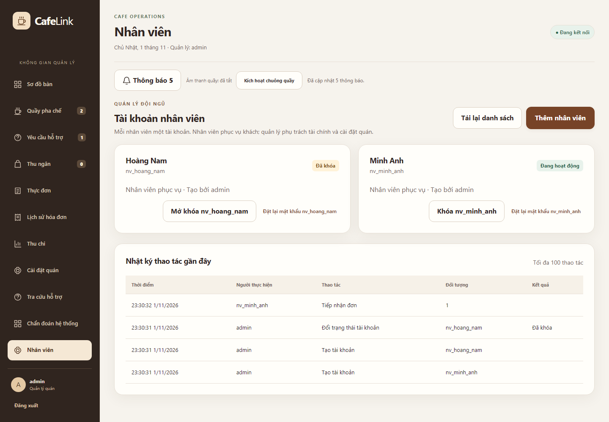

# CafeLink V10.1 - Quản lý và nhân viên

V10.1 bổ sung tài khoản nhân viên riêng và phân quyền trên nền [V10](UPGRADE_V10.md). Source hiện dùng schema 13, đang giữ local để người dùng nghiệm thu; công bố từ source; chưa phát hành portable mới. Báo cáo Word/PDF đã chốt và bằng chứng V9.4/V10 được giữ nguyên.

## Quyền sử dụng

| Thao tác | Quản lý - ADMIN | Nhân viên - STAFF |
|---|---|---|
| Xem bàn, QR và đơn đang xử lý | Có | Có |
| Tiếp nhận hoặc từ chối đơn chưa thanh toán | Có | Có, từ chối cần lý do |
| Pha chế, chuyển sẵn sàng và giao đồ | Có | Có, theo đúng trạng thái tiền/phục vụ |
| Xử lý hỗ trợ, thông báo và chuông quầy | Có | Có |
| Đánh dấu món đang bán thành hết/còn | Có | Có, không sửa giá hoặc nội dung món |
| Tạo/sửa món, giá, ảnh và nhóm thực đơn | Có | Không |
| Mở/tạm dừng bàn, dừng nhận đơn toàn quán, quản lý phiên khách | Có | Không |
| Thu ngân thủ công, lịch sử hóa đơn, thu chi, thuế và hoàn tiền giả lập | Có | Không |
| Chẩn đoán, tạo/khóa/mở khóa/đặt lại mật khẩu nhân viên | Có | Không |
| Xem nhật ký người thao tác | Có | Không |

Khách vẫn vào bằng QR, có giỏ/đơn/phiên riêng. STAFF được xem giá và tổng tiền của đơn đang phục vụ; điều này khác quyền xem doanh thu, báo cáo và hóa đơn lịch sử. Thông báo của STAFF chỉ thuộc các phiên còn hoạt động.

## Chạy để nghiệm thu

Từ source tại workspace:

```powershell
cd D:\BTL-LTM\cafelink-system
powershell -NoProfile -ExecutionPolicy Bypass -File scripts/build-web.ps1
powershell -NoProfile -ExecutionPolicy Bypass -File scripts/run-web.ps1 -Port 19788 -TcpPort 19758 -DatabasePath data/v10-roles-review/cafelink.db
```

1. Mở **http://127.0.0.1:19788/admin**, dùng quản lý local `admin / CafeLink@123`.
2. Vào **Nhân viên → Thêm nhân viên**, nhập tài khoản, họ tên và mật khẩu riêng tối thiểu 10 ký tự. Không có tài khoản STAFF dùng chung được seed sẵn.
3. Mở browser/profile độc lập, vào cùng `/admin`, đăng nhập bằng tài khoản vừa tạo. Màn nhân viên chỉ có **Sơ đồ bàn, Quầy pha chế, Yêu cầu hỗ trợ, Thực đơn**.
4. Quản lý **Mở tất cả bàn**, lấy QR; mở khách bằng một browser/profile thứ ba. Khách gửi đơn, nhân viên tiếp nhận, khách thanh toán giả lập, nhân viên pha chế và giao đồ.
5. Nhân viên vào **Thực đơn**, đánh dấu hết/còn. Tên, giá và ảnh không có nút sửa. Quản lý vẫn chỉnh thực đơn đầy đủ.
6. Quản lý vào **Nhân viên**, xem nhật ký tiếp nhận/chuyển bước/hỗ trợ/đổi tình trạng món có tài khoản và thời điểm thực hiện.
7. Mở hai tab nhân viên, quản lý **Khóa** tài khoản: cả hai phải về đăng nhập. **Mở khóa** không phục hồi tab cũ; phải đăng nhập lại. **Đặt lại mật khẩu** cũng thu hồi mọi phiên cũ.

Public HTTPS vẫn dùng [script hiện có](WEB_PUBLIC_DEMO.md). Tạo STAFF bằng tài khoản quản lý public và cung cấp mật khẩu riêng cho nhân viên. Cookie cùng profile được chia sẻ giữa các tab; dùng các profile độc lập để demo các vai trò đồng thời.

## Cách bảo vệ quyền

- Core kiểm tài khoản còn hoạt động và `auth_version` ở mỗi yêu cầu. Gateway có kiểm quyền bổ sung; sửa role trong body, bỏ nút ẩn hoặc gửi trực tiếp TCP không cấp thêm quyền.
- Danh sách hành động STAFF được định nghĩa tại `common/Permissions.java`. Kiểm quyền diễn ra trước đọc receipt, nên lệnh bị cấm không lấy được kết quả quản lý cũ bằng mã yêu cầu. Quyết định bỏ cũng kiểm quyền trên hành động gốc.
- Khóa/mở khóa/đặt lại mật khẩu tăng phiên bản xác thực. Core phát `AUTH_REVOKED`, Gateway chuyển `SESSION_ENDED` tới các tab. Phiên cũ không dùng được sau mở khóa. Cookie quầy có tiền tố riêng để không bị nhầm với token phục hồi khách QR.
- Đánh dấu hết/còn dùng `SET_MENU_AVAILABILITY`, chỉ nhận `menuId`, `expectedVersion`, `available`. Core từ chối payload thêm giá hoặc trường không cho phép và kiểm phiên bản khi có người khác vừa sửa món.
- Mật khẩu được băm PBKDF2 có salt; không trả hash/mật khẩu trong API, nhật ký thao tác hoặc lưu mật khẩu vào IndexedDB/localStorage. Hai lệnh tạo/đặt lại mật khẩu có fingerprint receipt băm chậm có salt; gửi lại cùng mã/nội dung trả kết quả cũ.
- Audit cùng transaction với thay đổi và receipt. Gửi lại cùng lệnh không ghi hai hành động. Tài khoản bị khóa được giữ để lịch sử còn truy vết; không có thao tác xóa tài khoản hoặc tạo ADMIN từ màn nhân viên.

`StaffAccounts.java` quản lý tài khoản và audit; `RoleAccessTest`, `StaffRoleIntegrationTest`, `web/tests/roles.spec.ts` kiểm quyền qua Core, HTTP/TCP và giao diện. `StaffAccountsPanel`, `StaffMenu`, `StaffTableDetails` là các màn mới. Giao tiếp nghiệp vụ vẫn qua TCP Core.

## Dữ liệu và giới hạn

DB V10/schema 12 tự nâng lên schema 13 khi chạy V10.1, giữ tài khoản quản lý, hash, phiên khách, đơn và receipt cũ. Migration kiểm foreign key sau khi nâng cấp. Dừng Server, sao lưu trước khi dùng DB đang có; V9.4/V10 cũ không đọc ngược schema 13. Đường dẫn review ở trên tạo dữ liệu riêng và không xóa DB demo cũ.

Phạm vi hiện tại là một quán với hai vai trò nội bộ cố định; chưa chia thêm thu ngân/pha chế/quản lý chi nhánh hoặc chấm công. Khóa tài khoản chặn truy cập mới, không xóa dữ liệu đã được người dùng chụp/lưu trước đó. Thanh toán vẫn giả lập. Kiểm trên browser engine không thay kiểm điện thoại vật lý.

## Kết quả kiểm

Kiểm local ngày 01/11/2026, dùng DB riêng và Core/Gateway thật:

| Phạm vi | Kết quả |
|---|---|
| Java unit/integration và hồi quy | 194 ca, 0 lỗi, 0 bỏ qua; gồm 14 ca quyền/migration/tài khoản và 3 ca HTTP/TCP mới |
| Chromium toàn bộ nhóm mặc định | 88 ca, 0 lỗi, 0 bỏ qua; chạy trước các chỉnh CSS cuối |
| Phân quyền trên ba browser engine | 8 ca trên mỗi engine Chromium, Firefox và WebKit, đều đạt |
| Kiểm lại sau chỉnh CSS | 8 ca phân quyền Chromium; 1 ca điều hướng/tạo nhân viên trên mỗi Firefox/WebKit đều đạt. Bộ dashboard riêng 6 ca cũng đạt; không ghép fixture bàn thủ công và QR tự động vào cùng DB |
| Ảnh và khả năng truy cập tự động | 17 màn/trạng thái, desktop 1440px và viewport điện thoại 375px; không tràn ngang toàn trang, không phát hiện vi phạm trong nhóm WCAG đã chọn, không có lỗi JS ngoài phản hồi auth dự kiến. Có 29 nhóm kết quả công cụ chưa tự kết luận, chưa coi là chứng nhận truy cập toàn diện |
| Build và bàn giao | Java package, TypeScript/Vite production/experiment, PowerShell parse, liên kết tài liệu, `git diff --check` đạt. Guard từ chối gắn nhãn sai phiên bản; portable V10.1 chưa phát hành. Hash báo cáo đã chốt và baseline E0 không đổi |

Bằng chứng local: `cafelink-system/target/roles-verification-20261101/summary.json`, JUnit XML, JSON từng engine, log và manifest source/JAR/assets. Bộ ảnh: `dist/CafeLink-Roles-V10.1-20261101/index.html` tại gốc workspace. Các ca mới bao gồm ma trận quyền, migration giữ dữ liệu/FK, sửa payload, phiên bị thu hồi, mật khẩu, nhật ký, quy trình phục vụ và mất phản hồi.



[Màn nhân viên trên viewport điện thoại](images/v10.1/staff-orders-mobile.png). Đây là ảnh chạy với dữ liệu riêng, không phải ảnh vận hành tại quán. Các số đo tải cũ không được đổi nhãn thành V10.1. Chưa kiểm điện thoại vật lý cho nâng cấp này; đang chờ nghiệm thu điện thoại cho nâng cấp mới.
