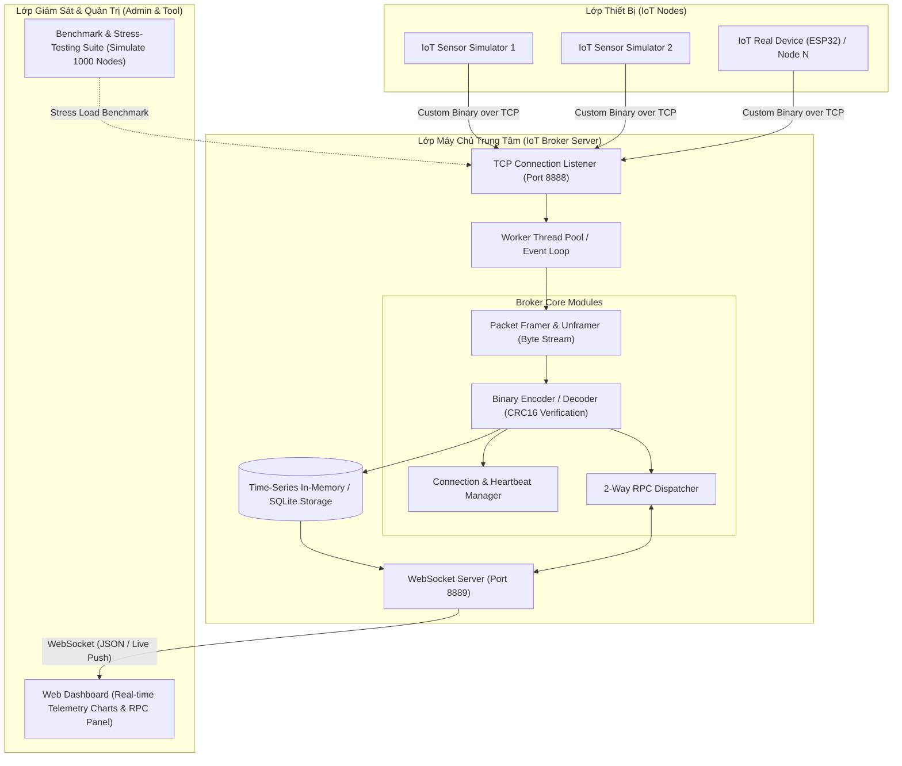
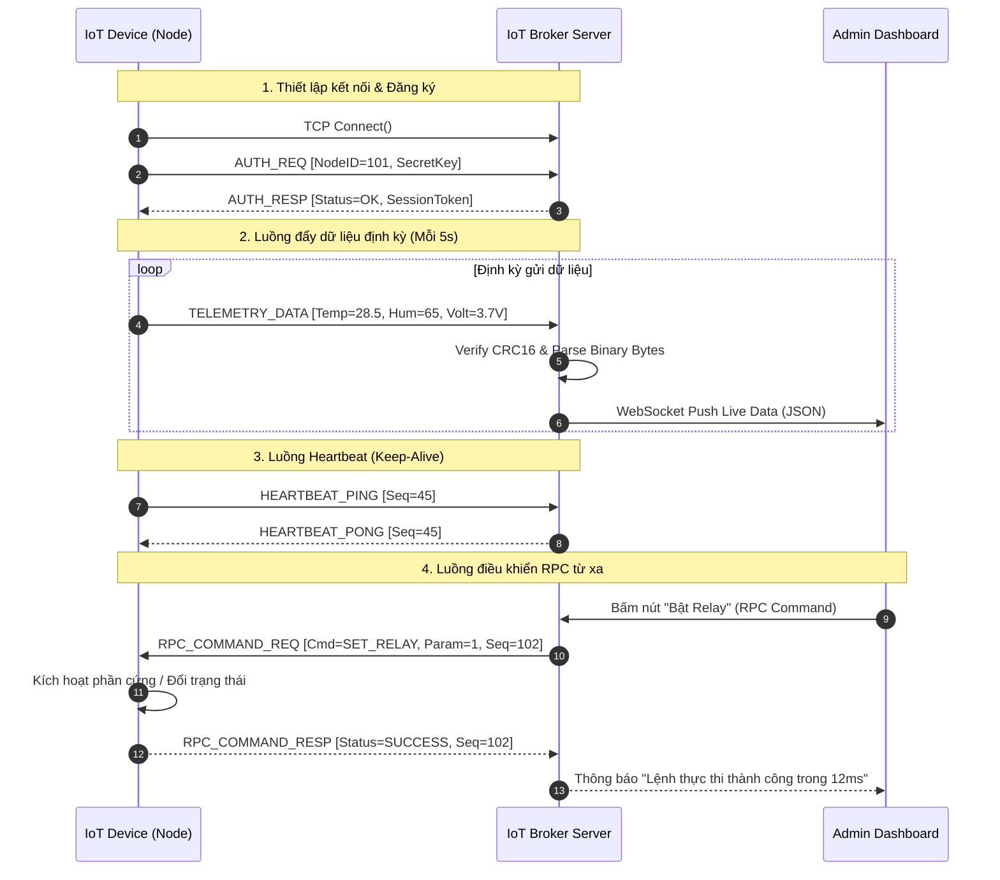

   # BÁO CÁO ĐẶC TẢ ĐỒ ÁN (PROJECT SPECIFICATION)
# HỌC PHẦN: LẬP TRÌNH MẠNG (NETWORK PROGRAMMING)

---

## 1. THÔNG TIN ĐỒ ÁN (PROJECT INFORMATION)

* **Tên đề tài tiếng Việt:** Hệ thống IoT Broker Giám sát và Điều khiển RPC qua Giao thức Nhị phân Tùy biến
* **Tên đề tài tiếng Anh:** Distributed IoT Telemetry and Remote RPC Broker System via Custom Binary Protocol
* **Tên viết tắt / Mã nộp bài:** `IoTRPCBroker` (hoặc `BioT-RPC`)
* **Chủ đề lựa chọn:** Topic 3 – Ứng dụng mạng và Hệ thống phân tán
* **Quy mô nhóm:** 03 thành viên
* **Thời gian thực hiện:** 08 tuần (02 tháng)

---

## 2. BỐI CẢNH VÀ ĐỘNG LỰC ĐỀ TÀI (PROBLEM & MOTIVATION)

### 2.1. Đặt vấn đề
Trong kỷ nguyên vạn vật kết nối (IoT), hàng triệu thiết bị cảm biến phân tán (giám sát môi trường, trạm thời tiết, đồng hồ thông minh, hộp đen định vị GPS) liên tục gửi dữ liệu về máy chủ trung tâm qua mạng di động (3G/4G/NB-IoT) hoặc mạng vô tuyến công suất thấp.

Tuy nhiên, việc sử dụng các giao thức dạng văn bản (Text-based) như **HTTP/REST hoặc JSON** truyền thống bộc lộ những hạn chế nghiêm trọng:
1. **Lãng phí băng thông:** Các thẻ văn bản (key names, dấu ngoặc `{ }`, dấu hai chấm) chiếm hơn 70% dung lượng gói tin, làm tăng chi phí gói cước SIM di động.
2. **Tiêu hao năng lượng:** Module truyền thông vô tuyến phải bật lâu hơn để gửi lượng dữ liệu lớn, làm giảm tuổi thọ pin của thiết bị.
3. **Quá tải tài nguyên vi điều khiển:** Các vi điều khiển giá rẻ (ESP32, STM32, Arduino) có dung lượng RAM rất hạn chế (vài chục KB). Việc phân tích cú pháp chuỗi JSON (String Parsing) đòi hỏi cấp phát bộ nhớ động (`malloc`), dễ gây phân mảnh bộ nhớ (Heap Fragmentation) và làm treo thiết bị.
4. **Nghẽn máy chủ khi mở rộng (High Concurrency Bottleneck):** Server tốn nhiều chu kỳ CPU để parse text từ hàng nghìn kết nối đồng thời.

### 2.2. Mục tiêu của đồ án
Xây dựng một hệ thống **IoT Broker hoàn chỉnh theo mô hình Client/Server phân tán**, trong đó:
* Tự thiết kế và cài đặt một **Giao thức nhị phân siêu nhẹ (Custom Binary Protocol)** tối ưu ở tầng Byte.
* Server có khả năng tiếp nhận và xử lý đồng thời hàng trăm/hàng nghìn kết nối từ thiết bị cảm biến với thông lượng cao.
* Hỗ trợ cơ chế **Điều khiển từ xa 2 chiều (Bi-directional RPC)** với độ trễ thấp.
* Cung cấp Dashboard quản trị giám sát dữ liệu thời gian thực và công cụ đo đạc thực nghiệm (Benchmark) đối sánh với giao thức JSON truyền thống.

---

## 3. PHẠM VI HỆ THỐNG (SCOPE)

### 3.1. In-Scope (Nội dung thực hiện)
* Thiết kế cấu trúc gói tin nhị phân (Binary Framing) có tích hợp mã kiểm tra toàn vẹn CRC16.
* Xử lý trọn vẹn hiện tượng phân mảnh và dính gói tin trên đường truyền TCP (Sticky Packet / TCP Framing).
* Xây dựng IoT Broker Server đa luồng (Thread Pool / Non-blocking I/O) quản lý kết nối, Heartbeat và phân phối lệnh RPC.
* Xây dựng bộ giả lập thiết bị (IoT Device Simulator) sinh dữ liệu cảm biến ngẫu nhiên theo thời gian thực và nhận lệnh RPC.
* Giao diện Dashboard quản trị trực quan hiển thị dữ liệu và bảng điều khiển thiết bị.
* Bộ công cụ đo đạc hiệu năng (Benchmark Stress-Tester) so sánh Binary vs JSON về: Băng thông, Throughput, RTT độ trễ và tải CPU/RAM.

### 3.2. Out-of-Scope (Không thuộc phạm vi)
* Thiết kế bo mạch phần cứng điện tử chuyên dụng (đề tài tập trung vào bản chất Lập trình Mạng, sử dụng thiết bị mô phỏng hoặc vi điều khiển chuẩn sẵn có như ESP32/PC Simulator).
* Tích hợp các dịch vụ đám mây thương mại trả phí (AWS/Azure).

---

## 4. KIẾN TRÚC HỆ THỐNG (SYSTEM ARCHITECTURE)



---

## 5. ĐẶC TẢ GIAO THỨC NHỊ PHÂN (CUSTOM BINARY PROTOCOL SPECIFICATION)

### 5.1. Cấu trúc Khung Gói Tin (Binary Frame Format)

Gói tin được thiết kế với **Header 12 Bytes cố định** + **Payload động** + **2 Bytes Checksum**:

```text
 0                   1                   2                   3
 0 1 2 3 4 5 6 7 8 9 0 1 2 3 4 5 6 7 8 9 0 1 2 3 4 5 6 7 8 9 0 1
+-+-+-+-+-+-+-+-+-+-+-+-+-+-+-+-+-+-+-+-+-+-+-+-+-+-+-+-+-+-+-+-+
|       Magic (2 Bytes: 0xABCD) |  MsgType (1B) |   Flags (1B)  |
+-+-+-+-+-+-+-+-+-+-+-+-+-+-+-+-+-+-+-+-+-+-+-+-+-+-+-+-+-+-+-+-+
|                       Sequence ID (4 Bytes)                   |
+-+-+-+-+-+-+-+-+-+-+-+-+-+-+-+-+-+-+-+-+-+-+-+-+-+-+-+-+-+-+-+-+
|                       Payload Length (4 Bytes)                |
+-+-+-+-+-+-+-+-+-+-+-+-+-+-+-+-+-+-+-+-+-+-+-+-+-+-+-+-+-+-+-+-+
|                   Payload Data (0 ~ N Bytes)                  |
|                               ...                             |
+-+-+-+-+-+-+-+-+-+-+-+-+-+-+-+-+-+-+-+-+-+-+-+-+-+-+-+-+-+-+-+-+
|                     CRC16 Checksum (2 Bytes)                  |
+-+-+-+-+-+-+-+-+-+-+-+-+-+-+-+-+-+-+-+-+-+-+-+-+-+-+-+-+-+-+-+-+
```

#### Chi tiết các trường trong Frame:
1. **Magic Number (2 Bytes - `0xABCD`):** Nhận diện điểm bắt đầu của gói tin hợp lệ, hỗ trợ khôi phục luồng byte khi bị lệch dữ liệu.
2. **Message Type (1 Byte):** Xác định loại thông điệp:
   * `0x01`: `AUTH_REQ` (Thiết bị đăng ký / xác thực).
   * `0x02`: `AUTH_RESP` (Server xác nhận đăng ký).
   * `0x03`: `TELEMETRY_DATA` (Thiết bị đẩy dữ liệu cảm biến định kỳ).
   * `0x04`: `HEARTBEAT_PING` (Thiết bị gửi duy trì kết nối).
   * `0x05`: `HEARTBEAT_PONG` (Server phản hồi sống).
   * `0x06`: `RPC_COMMAND_REQ` (Server gửi lệnh điều khiển tới thiết bị).
   * `0x07`: `RPC_COMMAND_RESP` (Thiết bị phản hồi kết quả thực thi lệnh).
   * `0x08`: `DISCONNECT` (Thông báo ngắt kết nối an toàn).
3. **Flags (1 Byte):** Cờ bit điều khiển (Bit 0: Có nén dữ liệu hay không; Bit 1: Yêu cầu ACK; Bit 2-7: Dự phòng).
4. **Sequence ID (4 Bytes - `uint32`):** Số thứ tự gói tin tăng dần (hỗ trợ ghép cặp Request - Response cho các cuộc gọi RPC).
5. **Payload Length (4 Bytes - `uint32`):** Độ dài chính xác của phần Payload (Bytes) $\rightarrow$ Khắc phục triệt để lỗi dính gói TCP.
6. **Payload Data (N Bytes):** Dữ liệu nghiệp vụ được đóng gói nhị phân (Big-Endian).
7. **CRC16 (2 Bytes):** Mã kiểm tra toàn vẹn dữ liệu cho toàn bộ Frame (áp dụng thuật toán CRC-16-CCITT).

---

### 5.2. Cấu trúc Payload Chi tiết cho từng thông điệp

#### A. Telemetry Data Payload (`MsgType = 0x03` - Tổng 15 Bytes):
* `NodeID` (`uint16` - 2B): Định danh thiết bị.
* `Timestamp` (`uint32` - 4B): Thời gian đo (Unix Epoch).
* `Temperature` (`int16` - 2B): Nhiệt độ tính theo ${}^\circ\text{C} \times 100$ (ví dụ: $2850 = 28.50^\circ\text{C}$).
* `Humidity` (`uint16` - 2B): Độ ẩm tính theo $\% \times 100$.
* `Voltage/Battery` (`uint16` - 2B): Điện áp pin tính theo $\text{mV}$ (ví dụ: $3700\text{mV}$).
* `StatusMask` (`uint8` - 1B): Bitmask trạng thái cảm biến và relay (Relay 1 ON/OFF, Sensor OK/ERR).
* `Reserved` (`uint16` - 2B): Dự phòng mở rộng.

#### B. RPC Command Request (`MsgType = 0x06` - Tổng 8 Bytes):
* `TargetNodeID` (`uint16` - 2B).
* `CommandID` (`uint16` - 2B): `0x0001` (SET_RELAY), `0x0002` (SET_REPORT_INTERVAL), `0x0003` (REBOOT).
* `ParamValue` (`int32` - 4B): Tham số thực thi.

---

### 5.3. Sơ đồ Luồng Truyền Thông (Sequence Flow)



---

## 6. XỬ LÝ NGOẠI LỆ VÀ KỸ THUẬT MẠNG CỐT LÕI (TECHNICAL MECHANISMS)

1. **Giải quyết triệt để Dính gói & Xé gói (TCP Framing State Machine):**
   * Server sử dụng một `ByteBuf` hoặc mảng tích lũy byte cho mỗi kết nối.
   * Tiến trình đọc: Đọc 2 byte đầu kiểm tra `Magic == 0xABCD`. Nếu đúng, đọc tiếp 10 byte Header để lấy `PayloadLength`. Chỉ khi nhận đủ `12 + PayloadLength + 2` byte mới tiến hành giải mã gói tin.
2. **Quản lý Kết nối Đa luồng (High Concurrency):**
   * Sử dụng kiến trúc Thread Pool / Non-blocking IO tách biệt giữa luồng tiếp nhận kết nối (Acceptor Thread) và luồng xử lý dữ liệu (Worker Threads).
3. **Cơ chế Phát hiện Mất mạng (Heartbeat & Dead-connection Reaper):**
   * Server duy trì bộ đếm thời gian (Timer). Nếu thiết bị không gửi Telemetry hoặc PING trong quá `30 giây` $\rightarrow$ Server tự động giải phóng tài nguyên Socket và cập nhật trạng thái `OFFLINE` lên Dashboard.
4. **Kiểm tra Toàn vẹn (CRC16 Data Integrity):**
   * Mọi frame bị sai lệch byte hoặc lỗi đường truyền sẽ bị loại bỏ ngay lập tức trước khi đi vào tầng xử lý logic.

---

## 7. ĐIỂM MỚI VÀ ĐÓNG GÓP KỸ THUẬT (NOVELTY & CONTRIBUTIONS)

| Tiêu chí | Baseline Truyền Thống (HTTP/JSON) | Giải pháp của Nhóm (BioT-RPC) |
| :--- | :--- | :--- |
| **Kích thước gói tin Telemetry** | ~65 – 80 Bytes | **15 Bytes** (Giảm **77%** băng thông) |
| **Thời gian giải mã tại Server** | Tốn CPU parse chuỗi, cấp phát `malloc` | Đọc trực tiếp byte stream (**Zero-Copy** / Tức thì) |
| **Giao tiếp 2 chiều (RPC)** | Phải dùng HTTP Polling (Chậm, trễ) | **2-Way Push trực tiếp qua TCP Socket** (Độ trễ < 20ms) |
| **Bảo vệ toàn vẹn dữ liệu** | Phụ thuộc tầng dưới | **Tích hợp CRC16 Checksum** cấp độ ứng dụng |
| **Khả năng chịu tải đồng thời** | ~200 req/sec trên máy đơn | **> 2.000 req/sec** với Thread Pool tối ưu |

---

## 8. KẾ HOẠCH THỰC NGHIỆM ĐO ĐẠC (MỤC 13, 14 TRONG BÁO CÁO)

Nhóm sẽ xây dựng bộ kịch bản đo đạc tự động để xuất biểu đồ số liệu cho báo cáo:

1. **Thực nghiệm 1 (Kích thước & Băng thông):**
   * So sánh tổng số MB truyền tải trong 24 giờ của 100 thiết bị giữa chuẩn JSON vs Custom Binary.
2. **Thực nghiệm 2 (Thông lượng & Tải CPU - Throughput Test):**
   * Sử dụng module Stress-Tester giả lập `100`, `500`, `1.000` thiết bị đồng thời gửi dữ liệu liên tục để đo số gói tin/giây (PPS) và % CPU Server.
3. **Thực nghiệm 3 (Độ trễ phản hồi RPC - Round-Trip Time):**
   * Đo thời gian từ lúc Admin bấm nút trên Dashboard đến khi nhận được ACK phản hồi từ thiết bị (mạng LAN và mạng Internet giả lập có trễ).
4. **Thực nghiệm 4 (Khả năng chịu lỗi - Fault Tolerance):**
   * Giả lập ngắt kết nối đột ngột của 50 thiết bị và kiểm tra thời gian Server phát hiện và dọn dẹp kết nối rác.

---

## 9. PHÂN CHIA NHIỆM VỤ NHÓM 3 NGƯỜI

| Thành viên | Trách nhiệm chính | Sản phẩm bàn giao cụ thể |
| :--- | :--- | :--- |
| **Thành viên 1**<br>*(Trưởng nhóm - Core Server & Protocol)* | • Thiết kế kiến trúc tổng thể và đặc tả chi tiết giao thức nhị phân.<br>• Lập trình TCP Socket Server đa luồng (Thread Pool/NIO).<br>• Lập trình module Framer, Decoder, Connection Manager, CRC16. | Source code Server lõi, quản lý kết nối và lưu trữ dữ liệu. |
| **Thành viên 2**<br>*(Simulator & RPC Engine)* | • Lập trình chương trình giả lập thiết bị (Sensor Simulator) đa tiến trình.<br>• Cài đặt module Encoder/Decoder nhị phân phía Client/Device.<br>• Cài đặt cơ chế nhận và thực thi lệnh 2-way RPC, gửi phản hồi ACK. | Tool giả lập 500 node sensor + Code firmware mẫu (nếu chạy trên ESP32). |
| **Thành viên 3**<br>*(Dashboard & Stress-Test Benchmarking)* | • Xây dựng giao diện Web Dashboard hiển thị biểu đồ realtime (WebSocket).<br>• Xây dựng bộ công cụ Stress-Tester đo đạc tự động các kịch bản thực nghiệm.<br>• Tổng hợp số liệu, vẽ biểu đồ và hoàn thiện báo cáo chuẩn Compilatio. | Giao diện Web quản trị + Script Stress-test + Toàn bộ biểu đồ thực nghiệm. |

---

## 10. LỘ TRÌNH TRIỂN KHAI 8 TUẦN (TIMELINE)

* **Tuần 1:** Thống nhất đặc tả giao thức nhị phân (Frame format, Message Type) và cấu trúc source code.
* **Tuần 2 – 3:** Hoàn thiện Core TCP Server + Module đóng gói/giải mã (Encoder/Decoder/CRC16) + Client kết nối cơ bản.
* **Tuần 4 – 5:** Cài đặt luồng Telemetry thời gian thực, cơ chế Heartbeat và bộ điều khiển lệnh 2-Way RPC.
* **Tuần 6:** Hoàn thiện Web Dashboard theo dõi và ghép nối toàn bộ hệ thống.
* **Tuần 7:** Chạy các kịch bản Stress-test (500–1.000 nodes), thu thập dữ liệu đo đạc hiệu năng, vẽ biểu đồ so sánh.
* **Tuần 8:** Viết báo cáo cuối cùng theo chuẩn `README.md` & `INSTRUCTION.md`, kiểm tra đạo văn Compilatio $\le 20\%$ và quay video demo.
