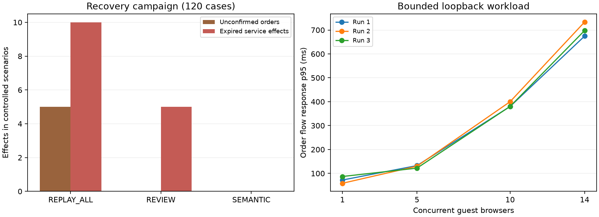

# CafeLink V9.4 - Nâng cấp độ tin cậy và kết quả kiểm thử

**Cập nhật sau mốc RC3:** trong bước chuẩn bị tính năng tiếp theo, CI phát hiện lỗi kết nối ở ca từ chối yêu cầu giả mạo. Đã bổ sung xử lý nội dung HTTP chưa nhận đủ và lưu JUnit cả khi gate thất bại. [Hồ sơ chuẩn bị](CafeLink_PreFeature_Readiness_20261030.md) ghi kết quả mới, bản RC4 và kit nghiệm thu. Số liệu RC3 bên dưới được giữ đúng mốc; không tự chuyển thành phép đo của RC4.

Ngày thực hiện: 30/10/2026. Phạm vi: source hiện hành sau V9.3; không sửa báo cáo DOCX người dùng đang biên tập, dữ liệu thật, baseline E0 hoặc bộ RC1 cũ. Mỗi phần được kiểm và push thành commit riêng.

## 1. Những thay đổi đã thực hiện

| Phần | Vấn đề trước sửa | Kết quả sau sửa | Commit |
|---|---|---|---|
| Sẵn sàng phục vụ | `/api/health` chỉ xác nhận Gateway và còn nhãn V7 | Tách liveness/readiness; probe qua TCP thật và đọc DB, deadline chung 500 ms, cache một giây; không phát snapshot vì đóng probe vô danh | `5842ddb` |
| Chẩn đoán quản lý | Khó biết tầng nào lỗi hoặc tra mã yêu cầu trong demo | Mục Chẩn đoán hệ thống: TCP/DB, kết nối, queue, số lỗi, thời gian Core/JVM và tối đa 100 trace; ADMIN ở cả Gateway/Core; không giữ payload/secret | `033ca93` |
| Hạn thanh toán | So sánh chuỗi ISO có thể sai thứ tự khi độ chính xác khác nhau; callback đúng hạn vẫn được nhận | Dùng `Instant`; đúng/sau expiresAt là hết hạn; lần cũ không ảnh hưởng lần mới; kiểm đồng thời không tạo hai lần thu | `ef04256` |
| Hồi quy desktop | Test chờ trạng thái của khách rồi bấm nút của chủ quán đang disabled | Chờ đúng nút, thêm fixture giữ chậm phản hồi sau commit để kiểm thứ tự; giữ các test legacy | `bb0c5fd` |
| Gói chạy/public | Chưa kiểm file frontend được thêm sau gate; nhãn gói cũ; URL tunnel được cấp trước khi edge kết nối | Kiểm danh sách file và từng hash, kèm VERIFICATION.json; nhãn V9.4; chờ edge rồi kiểm readiness công khai trước khi in link | `a540c08` |
| Âm thanh/trình duyệt | Bật chuông có thể chờ mãi, polling xóa cảnh báo âm; test clipboard chỉ dùng được ở Chromium | Timeout 2,5 giây, cảnh báo bền, thử lại/đóng context; kiểm Firefox/WebKit và nhánh fallback có ghi rõ giới hạn | `d654bc1` |

Chi tiết cơ chế, phân quyền, cách đọc số liệu và lệnh kiểm: [WEB_HARDENING.md](../cafelink-system/docs/WEB_HARDENING.md).

## 2. Cách xác minh

Các phép kiểm dùng Core/Gateway/SQLite thật với DB và cổng riêng. Fixture chỉ thay điều kiện lỗi cần kiểm: ngắt trước/sau nhận lệnh, giữ chậm phản hồi, từ chối/treo API âm thanh. Không sửa DB nghiệp vụ để làm cho assertion đạt. Các lượt FAIL được giữ riêng rồi liên kết với lượt sau sửa.

Các số test thuộc những bộ khác nhau, không cộng thành tỷ lệ bao phủ mã nguồn. PASS nói rằng các tình huống đã chọn đạt trong môi trường đã ghi; không chứng minh chương trình không còn lỗi.

### Kiểm phần mềm

| Bộ kiểm | Kết quả cuối | Bằng chứng |
|---|---|---|
| Java: protocol, network, service, web API, migration, recovery và desktop lịch sử | 162 PASS, 0 fail/error/skip | [Gate ngày 30/10 lúc 20:11](evidence/cafelink-v2/v9.4-gate/20261030-201106-19bc860f/summary.json) |
| Chromium: toàn bộ nhóm web | 71 PASS, 0 skip/flaky | Cùng gate, gồm JSON từng nhóm và ảnh |
| Firefox | 20 PASS, 0 skip/flaky | [Bộ tương thích](evidence/cafelink-v2/v9.4-hardening/compatibility-20261030-200703-4c7034b3/summary.json) |
| WebKit trên Windows | 20 PASS, 0 skip/flaky | Cùng bộ tương thích; có nhánh cảnh báo khi audio không dùng được |
| Guard ghép build với gate | 9 PASS | [Summary guard](evidence/cafelink-v2/v9.4-hardening/phase5-release-rc2/build-guard.json), `tools/test_build_gate.py` |
| Kiểm logic phân tích số đo | 3 PASS | `tools/test_web_analysis.py`: percentile, số liệu không hợp lệ và chặn campaign thiếu/lỗi |

Hash JAR và frontend trong bộ tương thích trùng với gate đầy đủ. [Summary phần 6](evidence/cafelink-v2/v9.4-hardening/phase6-audio-and-compatibility/summary.json) ghi liên kết kiểm và phạm vi âm thanh. Guard thực tế cũng từ chối dùng gate của frontend trước sửa âm thanh cho build mới.

Các mốc trước: phần 1 đạt 150 Java; phần 2 đạt 154 Java/69 Chromium; phần 3 đạt 162 Java/69 Chromium. Những mốc này được giữ để truy vết tiến độ.

Các test mới có ca đỏ trước sửa: phản hồi readiness nhỏ giọt; năm ca hạn thanh toán; bốn ca guard đóng gói; hai ca lỗi âm thanh. Lỗi test Swing có bằng chứng CI và fixture kiểm lại thứ tự phản hồi. Test clipboard được điều chỉnh theo khả năng tự động hóa của engine, không bỏ kiểm sao chép/nhánh từ chối.

CI khi công bố hồ sơ còn phát hiện một assertion tìm lời phản hồi trên toàn trang, nên khớp đồng thời toast và trạng thái hỗ trợ. Bài test được sửa để kiểm đúng vùng hỗ trợ, số ticket và trạng thái đã phản hồi; các assertion tương tự ở phục hồi/tính tiền được giới hạn vào vùng nghiệp vụ tương ứng. [Bằng chứng và kết quả sửa selector](evidence/cafelink-v2/v9.4-hardening/phase8-e2e-selectors/summary.json) giữ lượt CI thất bại. Đây là sửa bài test, không thay runtime/gói RC3 hoặc xóa thông báo đang hoạt động đúng.

### Kiểm gói và đường public

**Gói của mốc kiểm dưới đây: `dist/CafeLink-Web-V9.4-RC3.zip`.** Gói này chứa frontend sau sửa âm thanh và được ghép đúng gate 20:11. SHA-256:

```text
6FE0B497F2B1CBBA404312A6977B6E3D9F31ACBF2510986CB1C7197EBA4A7BB3
```

RC3 đạt **23/23 nhóm kiểm gói** trên JRE đi kèm khi PATH của tiến trình không có Java/Node/npm máy phát triển: [kết quả gói](evidence/cafelink-v2/v9.4-hardening/phase7-release-rc3/package-smoke.json), [summary](evidence/cafelink-v2/v9.4-hardening/phase7-release-rc3/summary.json). Nội dung bao gồm thay đổi ở quầy/khách, ảnh menu, quyền, mất phản hồi, restart, backup/reset/restore, khóa profile, kiểm toàn vẹn và từ chối cổng đang dùng.

**8/8 kiểm public HTTPS/WSS đạt**: readiness TCP/DB; cookie Secure/HttpOnly; đúng origin QR; API phục hồi trong secure context; hai khách có đơn/thanh toán riêng; WSS và tự kết thúc phiên; từ chối Origin lạ; từ chối mật khẩu admin mặc định. [Kết quả browser](evidence/cafelink-v2/v9.4-hardening/phase7-release-rc3/public/public-browser.json), [dọn tunnel/listener](evidence/cafelink-v2/v9.4-hardening/phase7-release-rc3/public/public-package.json). Không lưu mật khẩu tạm vào evidence và không để tunnel của test tiếp tục chạy.

RC2 là mốc trước bản sửa âm thanh. [Lượt public đầu thất bại](evidence/cafelink-v2/v9.4-hardening/phase5-release/summary.json) do tunnel nối edge trễ được giữ riêng. Khi thử bản mới, chọn RC3; các candidate trước đó không phải gói chốt này. Runtime ZIP giữ tại workspace, không đưa vào Git; người clone dùng quy trình build từ source.

GitHub CI sau sửa selector, commit `70e8f2d`, đã thành công trên [main](https://github.com/hieupham03/Cafe-link/actions/runs/41065467863) và [submission/cafelink](https://github.com/hieupham03/Cafe-link/actions/runs/41065467829). [Gate tải từ artifact CI](evidence/cafelink-v2/v9.4-hardening/phase8-e2e-selectors/ci-green-gate.json) xác nhận 162 Java, 71 Chromium, không fail/error/skip/flaky và đã đóng listener test. [Phiếu kiểm cuối](evidence/cafelink-v2/v9.4-hardening/final-verification.json) ghi hash/bằng chứng và trạng thái CI khi công bố hồ sơ. Các sửa sau `d654bc1` chỉ liên quan tài liệu và bài test, không thay runtime trong RC3.

### Thực nghiệm trên source mới

Run mới: [summary](evidence/cafelink-v2/v9.4-hardening/measurements-20261030/summary.json), [analysis](evidence/cafelink-v2/v9.4-hardening/measurements-20261030/analysis.json), [môi trường và hash](evidence/cafelink-v2/v9.4-hardening/measurements-20261030/environment.json). Máy Windows, i7-12700H, RAM khoảng 16 GB, JVM 24.0.2, Node 22.20.0; Chromium/Gateway/TCP Core/SQLite cùng host loopback. Gate Java 17 trên CI và JRE 17 của gói được kiểm riêng.

**120/120 ca phục hồi PASS**: tám tình huống x ba policy x năm lần, có oracle DB. Kết quả mỗi policy trên 40 ca:

| Policy | Đơn tạo lại khi khách chưa xác nhận | Lời gọi hết nhu cầu vẫn có tác dụng | Sai phiên / đơn trùng | Lần cần khách quyết định | p95 phục hồi |
|---|---:|---:|---:|---:|---:|
| REPLAY_ALL | 5 | 10 | 0 / 0 | 0 | 42,0 ms |
| REVIEW | 0 | 5 | 0 / 0 | 15 | 35,6 ms |
| SEMANTIC | 0 | 0 | 0 / 0 | 5 | 50,4 ms |

Cả ba policy cùng có receipt/idempotency và guard quyền/phiên. Bảng cho thấy khác biệt về quyết định đối với yêu cầu chưa được nhận trong các tình huống đã dựng; không gán riêng khả năng chống trùng cho SEMANTIC hoặc gọi cơ chế này là thuật toán mới. "Hết nhu cầu" là điều kiện giả định trong kịch bản, không phải nhu cầu của khách thật được đo.

**12/12 lượt tải PASS**, ba lần ở mỗi mức; warmup 3 giây, đo 15 giây; mỗi khách được lên lịch một flow/giây. Có **1.256 flow hoàn tất, 0 lỗi flow và 0 lỗi HTTP đã ghi**; oracle đối chiếu đủ đơn/tiền.

| Khách đồng thời | Flow hoàn tất / slot dự kiến qua ba lần | Slot lỡ | p95 phản hồi đặt món từng lần |
|---:|---:|---:|---|
| 1 | 45 / 45 | 0 | 58,6-87,0 ms |
| 5 | 225 / 225 | 0 | 122,0-132,6 ms |
| 10 | 450 / 450 | 0 | 380,0-400,1 ms |
| 14 | 536 / 630 | 94 | 674,6-733,7 ms |

Ở mức 14 khách, một số vòng đặt món/thanh toán kéo dài qua mốc lịch kế tiếp; driver ghi slot lỡ rồi bỏ lượt chưa phát, không dồn gửi bù. **94 slot này chưa phát thành yêu cầu, không phải 94 đơn đã nhận bị mất.** Kết quả PASS của campaign chỉ xác nhận các thao tác đã chạy và oracle đúng, không nói đạt đủ nhịp nguồn phát. Mức 14 khách với một flow mỗi người mỗi giây đã bộc lộ giới hạn trong điều kiện đo; không xem giới hạn 30 guest cấu hình là công suất đã chứng minh.

Số liệu V9.3 ngày 25/10 là run riêng. Chưa có đối chứng cùng điều kiện để kết luận tốc độ thay đổi do từng bản sửa. Mẫu có tương quan trong một lượt chạy; các phép đo trên cùng máy không thay nghiệm thu mạng vật lý hoặc thiết bị thật.



Biểu đồ sinh từ raw của run này. Đường p95 chỉ dùng các flow đã hoàn tất; cần đọc cùng bảng slot lỡ phía trên để đánh giá mức tải 14 khách.

## 3. Tự chạy lại

Tại `cafelink-system`:

```powershell
powershell -NoProfile -ExecutionPolicy Bypass -File scripts/test-web.ps1 -Phase V9.4
powershell -NoProfile -ExecutionPolicy Bypass -File scripts/test-browser-compatibility.ps1
python tools/test_build_gate.py
```

Gate thường chạy Chromium; script tương thích chạy riêng Firefox/WebKit. Để đo lại dùng `scripts/experiment-web.ps1` với `-OutputPath` trỏ tới thư mục mới. Không tái dùng thư mục đã có bằng chứng.

Chạy gói RC3 tại workspace, chọn cặp cổng trống:

```powershell
cd D:\BTL-LTM\dist\CafeLink-Web-V9.4-RC3
.\START-LOCAL.cmd -Port 19588 -TcpPort 19558
```

Mở `http://127.0.0.1:19588/admin`, tài khoản local `admin / CafeLink@123`. Vào **Chẩn đoán hệ thống** để xem tình trạng; mở tất cả bàn, lấy nguyên link đặt món và dùng browser/profile khác cho khách. Để chạy public, dừng local bằng Ctrl+C rồi dùng:

```powershell
.\START-PUBLIC.cmd -Port 19588 -TcpPort 19558
```

Dùng địa chỉ HTTPS và mật khẩu tạm do terminal in ra. Local/public có profile riêng. Không xóa dữ liệu thật để thử lại; các bài test tự động đã dùng DB riêng.

## 4. Còn cần người dùng xác nhận

- Điện thoại thật: camera quét QR, Safari/iOS và Chrome/Android, chạm/bàn phím, xoay màn hình, khóa/mở máy và mạng Wi-Fi/4G.
- Hai máy hoặc mạng LAN vật lý; chất lượng Internet/tunnel khi thuyết trình. Các lần thử tự động public đã dừng, link cũ không phải địa chỉ demo đang hoạt động.
- Âm thanh thực sự phát qua loa. Test engine có thể xác nhận AudioContext chạy hoặc nhánh cảnh báo; không chứng minh người dùng nghe được chuông.
- Nghiệm thu nghiệp vụ trực tiếp của người dùng/giảng viên. Thanh toán vẫn là giả lập, không có ngân hàng thật.

Thông tin nhóm, Compilatio, biên tập Word và nộp chính thức thuộc các công việc khác. Bản nâng cấp không tự hoàn thành những việc đó.
