# CafeLink — Hệ thống gọi món và điều phối phục vụ theo mô hình Client/Server

## Tóm tắt — Abstract

Sau khi mất phản hồi đặt món, khách không biết quán đã nhận đơn hay cần gửi lại. Việc gửi lại còn có thể tạo một lời gọi nhân viên khi nhu cầu đã hết. CafeLink cung cấp website gọi món QR và màn điều phối tại quầy. Browser giao tiếp HTTP/WebSocket với Gateway; Gateway gửi frame JSON có tiền tố độ dài tới Core qua TCP. Hệ thống lưu nhật ký ý định ở Client và kết quả xử lý tại Core: đơn chưa được nhận chờ khách xác nhận, còn lời gọi hỗ trợ ngắn hạn chưa nhận được ghi dấu bỏ để chặn lệnh tới muộn.

Trong 120 ca phục hồi, ba chính sách R0 (gửi lại), R1 (chờ xem xét) và R2 (theo loại yêu cầu) tạo lần lượt 10, 5 và 0 ticket khi kịch bản quy định nhu cầu đã hết. Mười hai lượt tải trên một host hoàn tất 1.348/1.350 slot; p95 phản hồi đặt món tăng từ 54,00–63,20 ms ở một Client giả lập lên 488,80–540,00 ms ở 14 Client giả lập, còn hai slot lỡ. Đóng góp của đề tài là tích hợp quyết định phục hồi theo loại yêu cầu với dấu bỏ lưu bền trong phạm vi phiên. Kết quả kiểm chứng thiết kế ở các kịch bản đã chọn; chưa đánh giá hiệu quả vận hành tại quán thật.

**Từ khóa — Keywords:** TCP Socket; Client/Server; semantic recovery; idempotency; session fencing; QR ordering.

## 1. Giới thiệu

Một khách chọn cà phê, bấm đặt món rồi thấy màn hình báo mất kết nối. Quán có thể đã nhận đơn nhưng phản hồi không tới, hoặc chưa nhận được lệnh. Với khách, hai tình huống trông gần giống nhau; với hệ thống, chúng đòi hỏi cách xử lý khác nhau. Trường hợp thứ nhất cần lấy lại đúng kết quả. Trường hợp thứ hai cần khách quyết định có tiếp tục mua sau gián đoạn. Tự gửi lại một lời gọi nhân viên còn có thể tạo việc thừa nếu nhu cầu đã hết. Đây là tình huống thiết kế mà CafeLink tập trung giải quyết.

CafeLink chọn phạm vi một quán nhỏ, sáu bàn và tám món mẫu. QR cố định xác định vị trí giao đồ; phiên riêng của khách (private visit) xác định lượt và quyền sử dụng. Nhiều người cùng bàn có thể gọi và trả tiền riêng, không cần nhân viên mở/đóng bàn cho từng lượt. Luồng chính là quét QR, chọn món, trả trước giả lập rồi pha chế/phục vụ; gọi hỗ trợ là luồng riêng. Phạm vi này không bao gồm kho nguyên liệu, kế toán, topping phụ thu hoặc nhiều chi nhánh.

Đề tài thuộc Topic 3 về ứng dụng mạng (Tài liệu học phần Lập trình mạng, 2026). Website giúp khách sử dụng trên điện thoại; trọng tâm kỹ thuật là giao thức, nhiều kết nối, trạng thái dùng chung và xử lý lỗi. Báo cáo đặt hai câu hỏi nghiên cứu:

- **RQ1:** Phục hồi theo loại yêu cầu kết hợp dấu bỏ bền có giảm tác dụng ngoài ý muốn so với replay/review trong các kịch bản đã định nghĩa không?
- **RQ2:** Độ trễ, thông lượng và lỗi thay đổi thế nào khi tăng workload gọi món/thanh toán trên cùng host?

C1 là cơ chế phục hồi phân biệt đơn cần khách xác nhận với lời gọi ngắn hạn chưa được nhận. C2 là dấu bỏ lưu tại Core, được quyết định trong cùng ranh giới transaction với việc tiếp nhận lệnh và giữ phạm vi phiên. Mục 8 xác định cách đánh giá; mục 9 đối chiếu kết quả với hai câu hỏi nghiên cứu.

## 2. Kiến thức nền và công trình liên quan

TCP cung cấp luồng byte có thứ tự, không cung cấp ranh giới JSON cho ứng dụng (Eddy, 2022). CafeLink vì thế cần framing và đọc đủ header/body. HTTP xử lý request/response, WebSocket duy trì kênh hai chiều sau handshake (Fette & Melnikov, 2011; Fielding và cs., 2022). TCP chuyển dữ liệu tin cậy không đồng nghĩa Browser biết chắc một transaction nghiệp vụ đã commit khi response ứng dụng bị mất.

Idempotency key là kỹ thuật đã được dùng trong API thực tế. Tài liệu chung của Square mô tả cách retry cùng key (Square, không năm-b); cụ thể, CreateOrderRequest cho phép dùng lại key khi chưa chắc đơn đã được tạo, nhằm tránh tạo đơn trùng (Square, không năm-a). Vì vậy, chỉ thêm ID chống trùng vào một hệ thống gọi món chưa đủ để làm contribution của CafeLink. Câu hỏi nhóm bổ sung là **có nên tiếp nhận một ý định chưa có kết quả sau gián đoạn**, và làm thế nào giữ quyết định bỏ nếu bản sao lệnh vẫn tới muộn.

Ở lớp thanh toán, Square cũng cung cấp chế độ lưu giao dịch ngoại tuyến rồi xử lý khi kết nối trở lại; tài liệu nêu rủi ro giao dịch bị từ chối hoặc hết hạn (Square, không năm-c). Điều đó cho thấy phục hồi sau gián đoạn có giá trị thực tiễn, nhưng quy trình xử lý tiền khác với quyết định giữ hay bỏ lời gọi hỗ trợ. CafeLink chỉ giả lập thanh toán; phần thực nghiệm không kiểm tiền thẻ hoặc cơ chế ngoại tuyến của Square.

Bảng: Phạm vi nguồn liên quan và câu hỏi CafeLink đánh giá

| Nguồn/cơ chế | Vấn đề được tài liệu giải quyết | Quan hệ với CafeLink |
|---|---|---|
| TCP, HTTP và WebSocket (Eddy, 2022; Fette & Melnikov, 2011; Fielding và cs., 2022) | Truyền byte, giao tiếp request/response và kênh hai chiều | Chọn cách đóng frame và trao đổi; không suy ra kết quả commit từ trạng thái connection |
| Square CreateOrderRequest (Square, không năm-a) | Retry cùng key khi chưa chắc tạo đơn thành công | Căn cứ kỹ thuật chống trùng đã phổ biến; CafeLink nghiên cứu thêm quyết định với ý định chưa nhận |
| Square offline payments (Square, không năm-c) | Lưu và xử lý thanh toán sau gián đoạn, có rủi ro cần quản lý | Ví dụ nhu cầu khôi phục thực tế ở lớp tiền; không phải baseline thực thi của nhóm |
| IndexedDB, SQLite và Web Locks (W3C, 2025a; SQLite, không năm-b; W3C, 2025b) | Transaction cục bộ và phối hợp truy cập | Công cụ xây journal/receipt/khóa tab; policy nghiệp vụ vẫn do CafeLink xác định |

IndexedDB lưu journal có transaction ở Browser; SQLite lưu trạng thái và receipt của Core (W3C, 2025a; SQLite, không năm-b). Không có transaction phân tán nguyên tử bao trùm hai nơi, nên cần đối chiếu sau lỗi. Web Locks giúp các tab dùng chung vùng lưu trữ trong cùng trình duyệt phối hợp việc phục hồi (W3C, 2025b). Những nền tảng này hỗ trợ giải pháp, nhưng không thay quyết định nghiệp vụ.

Từ các cơ chế trên, bài toán cần phân biệt hai quyết định: nhận lại kết quả của lệnh đã commit và có tiếp nhận ý định chưa có kết quả hay không. ID chống trùng hỗ trợ quyết định thứ nhất. Với quyết định thứ hai, việc lookup chưa thấy receipt vẫn không loại trừ lệnh gốc sẽ tới sau. CafeLink bổ sung policy theo loại yêu cầu và dấu bỏ bền để xử lý khoảng hở này trong luồng gọi món QR.

Thí nghiệm dùng R0 (gửi lại) và R1 (chờ xem xét) làm đối chứng cho R2 (phục hồi ngữ nghĩa); cả ba chạy cùng Core, idempotency, quyền và kiểm tra phiên. Khoảng hở được đánh giá là của workflow và đối chứng đã chọn. Tài liệu công khai không đủ để kết luận Square thiếu một cơ chế nội bộ, hoặc CafeLink vượt POS thương mại. Đóng góp là thiết kế tích hợp cùng phép đánh giá kiểm lại được.

## 3. Định nghĩa bài toán

### 3.1. Tác nhân và phạm vi quyền

Bảng: Tác nhân, đầu vào và đầu ra

| Tác nhân | Đầu vào chính | Đầu ra mong đợi |
|---|---|---|
| Khách | QR, lựa chọn món/số lượng/ghi chú, quyết định trả thử, lời nhắn | Giỏ đúng, một kết quả cho mỗi ý định đã nhận, tiến độ/receipt đúng quyền |
| Quản lý/quầy | Tài khoản, danh mục/ảnh, cập nhật pha chế/giao, hỗ trợ, từ chối/hoàn | Hàng đợi đúng, audit và lịch sử tiền/đơn nhất quán |
| Server | Message từ nhiều connection, command ID, scope, version | Xác thực, quyết định trạng thái, transaction, response/event |

Mỗi browser profile có membership/private visit riêng. Khách mới quét cùng QR không được xem đơn người trước; hai tab trong cùng profile có thể dùng chung cookie/journal. QR không chứng minh người quét đang hiện diện tại quán. Scope store/visit/membership phải xuất phát từ quyền đã cấp, không tin tableId hoặc role do Client tự khai.

### 3.2. Quy tắc nghiệp vụ

Core tính giá theo số nguyên VND và kiểm purchase version. Giỏ có tối đa 20 dòng, tổng tối đa 20 phần cho mỗi menu ID. Hai phần cùng món khác ghi chú được giữ riêng. Đổi giá/ngừng bán yêu cầu khách xem lại; đổi ảnh/mô tả không làm vô hiệu xác nhận mua một cách không cần thiết.

Tiền và phục vụ là hai trục ở Hình 1. Trong PREPAY, chỉ bắt đầu pha chế khi PAID; chỉ ghi SERVED khi đã giao đủ. Đơn chưa trả có thể hủy theo guard. Đơn PAID chưa pha chế có thể bị quầy từ chối/hoàn giả lập có lý do và audit. LOCAL_SIMULATOR không xác nhận tiền ngân hàng.

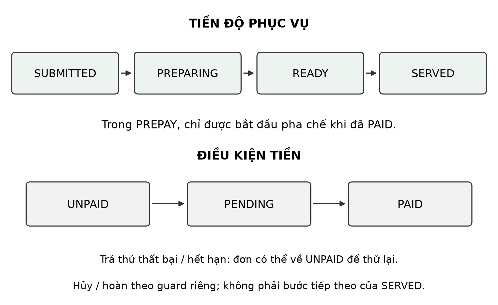

Mỗi loại hỗ trợ có tối đa một ticket OPEN trong visit; bổ sung/rút dùng expectedVersion để tránh ghi đè cập nhật. Dừng nhận đơn mới không xóa nghĩa vụ đã nhận. Phiên chỉ tự hoàn tất khi hết nghĩa vụ; mất connection hoặc tắt điện thoại không phải tín hiệu khách đã đi.

### 3.3. Bất biến cần bảo vệ

Bảng thuật ngữ dưới phân biệt ý định phía khách với dữ liệu quán đã nhận. Các tên trường/action giữ nguyên để đối chiếu source (CafeLink, 2026b).

Bảng: Thuật ngữ dùng trong thiết kế phục hồi

| Thuật ngữ | Ý nghĩa trong CafeLink | Vai trò khi có lỗi |
|---|---|---|
| Ý định và command ID | Một lần khách quyết định thực hiện thao tác; ID được giữ khi thử lại | Retry cùng ý định không trở thành một lần mua mới |
| Journal | Nhật ký cục bộ trong IndexedDB, ghi trước gửi | Giữ nội dung và tình trạng cần đối chiếu sau mất phản hồi |
| Receipt | Bản ghi kết quả theo danh tính (principal) và command ID tại Core | Lookup lấy lại kết quả đã chốt; khác với hóa đơn bán hàng |
| Fingerprint | Dấu nhận dạng nội dung action/payload của ý định | Phát hiện tái dùng ID cho nội dung khác; không dùng thay xác thực |
| Scope | Phạm vi quán/visit/membership đã được cấp quyền | Không chuyển yêu cầu của khách/lượt cũ sang phiên khác |
| Barrier bền | Receipt ghi quyết định bỏ trước tiếp nhận, cùng cơ chế transaction | Lệnh cùng ý định đến sau không được tạo tác dụng mới |
| Revision/version và guard | Số phiên bản cùng điều kiện hợp lệ trước thao tác | Giữ nháp mới, chống ghi đè hoặc chuyển trạng thái sai |

Thiết kế bảo vệ bốn bất biến. Thứ nhất, với một danh tính và ID đã chốt, nội dung khớp chỉ nhận lại cùng kết quả; đổi payload bị từ chối. Thứ hai, lệnh thuộc lượt cũ không tự đổi sang lượt mới. Thứ ba, accept thắng phải giữ kết quả đã nhận, còn discard thắng phải chặn tác dụng mới của lệnh đến muộn. Thứ tư, giỏ nháp, đơn đã gửi, tiền đã trả và công việc đã giao luôn được phân biệt. Hai ID khác nhau vẫn có thể biểu diễn hai lần mua hợp lệ; cơ chế không cố đoán rằng hai đơn giống món là trùng.

## 4. Giải pháp đề xuất

### 4.1. Journal trước gửi và phục hồi theo loại yêu cầu

Client hoàn tất ghi IndexedDB trước khi phát mutation. Journal giữ ID, action, scope, payload/fingerprint, revision giỏ và trạng thái. Không ghi được journal thì không gửi với cam kết phục hồi không có cơ sở. Timeout giữ trạng thái chưa rõ, không tự tạo command mới.

Khi nối lại, Client kiểm quyền và tra receipt. Kết quả phải khớp action/fingerprint trước khi áp vào UI. Chỉ dọn giỏ nếu revision còn phù hợp, tránh xóa nháp mới ở tab khác. Các ý định chưa rõ không bị xóa chỉ để làm sạch màn hình.

Bảng: Quyết định phục hồi theo ngữ nghĩa

| Trường hợp | SEMANTIC quyết định | Lý do nghiệp vụ |
|---|---|---|
| Core đã nhận | Lấy lại kết quả cũ | Không bắt khách đặt/thu tiền lại do mất response |
| Đơn chưa nhận, scope còn phù hợp | Chờ xác nhận hoặc bỏ | Quyết định mua cần còn hiệu lực |
| Lời gọi/bổ sung ngắn hạn chưa nhận | Bỏ ý định cũ | Khách còn cần thì phát nhu cầu mới |
| Scope cũ đã kết thúc | Không tự chuyển lệnh, bỏ theo policy | Cùng bàn không đồng nghĩa cùng lượt/quyền |
| Kết quả không khớp | Khóa tự xử lý, nhờ đối chiếu | Không đoán hoặc sửa payload đã gửi |
| Rút hỗ trợ chưa nhận, scope còn phù hợp | Chờ xác nhận hoặc bỏ; không tự rút lại | CANCEL_SERVICE là quyết định khác với gọi/bổ sung ngắn hạn |

Khi scope còn phù hợp và chưa có receipt, `CALL_SERVICE`/`AMEND_SERVICE` được SEMANTIC bỏ, còn `PLACE_ORDER`/`CANCEL_SERVICE` chờ khách xác nhận hoặc bỏ. Rút hỗ trợ là quyết định dừng một yêu cầu đang có; bỏ ý định rút chưa được nhận không tự hủy ticket gốc. Nếu Core đã nhận thao tác rút, lookup lấy lại kết quả CANCELLED và version tương ứng thay vì yêu cầu khách thực hiện lại. Nhánh theo loại chỉ được xét sau bước đối chiếu, nên không áp quy tắc bỏ lên một kết quả đã được nhận.

Sau khi phản hồi khớp, Client đợi transaction ghi trạng thái/kết quả vào IndexedDB hoàn tất rồi mới coi ý định trong journal đã giải quyết. Nếu ghi lỗi, journal vẫn cần đối chiếu ở lần mở sau. WebSocket có thể đã hiển thị đơn ở luồng đọc độc lập; việc chưa ghi được kết quả journal không làm Core quên đơn hoặc cho phép Client tự tạo một ID thay thế. Dọn giỏ và lưu quyết định phải xét revision của nháp hiện tại.

Các trạng thái journal giúp phân biệt tiến trình phục hồi: PENDING là chưa rõ kết quả; CONFIRM_REQUIRED chờ quyết định; ACCEPTED đã có kết quả khớp; CANCELLED là ý định bị bỏ trước tiếp nhận; REJECTED là từ chối xác định; BLOCKED cần đối chiếu do quyền/nội dung bất thường. CANCELLED của journal không đồng nghĩa hoàn tiền hay hủy một đơn đã được nhận. Những entry chưa rõ không được dọn theo chính sách lưu lịch sử của entry đã giải quyết.

### 4.2. Barrier bền và ranh giới phiên

Lookup chưa thấy kết quả không ngăn bản sao lệnh đang đi tới Core. `DISCARD_COMMAND` dùng cùng kiểm ID/fingerprint và ranh giới transaction với accept. Nếu chưa nhận, Core lưu receipt có dấu `cancelledBeforeAcceptance`; nếu đã nhận, Core trả kết quả cũ. Hình 2 thể hiện hai thứ tự cần kiểm. Discard không rollback công việc đã nhận.

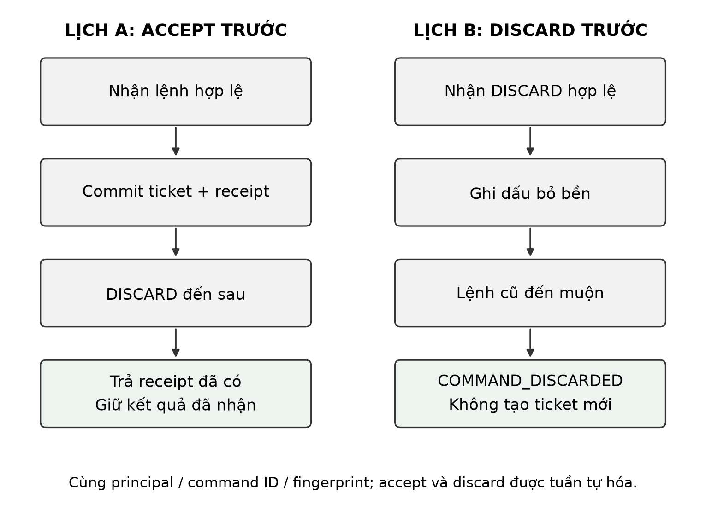

Scope cũ không được tự thay bằng quyền của lượt mới. Continuation chỉ chuyển giỏ nháp có kiểm soát và liên kết lịch sử riêng; command đã gửi vẫn thuộc scope ban đầu. Khi còn xác thực và đối chiếu được phạm vi cũ, policy có thể ghi dấu bỏ cho ý định chưa nhận của lượt đã hết. Nếu mất quyền, không khớp scope hoặc không đọc được trạng thái, Client giữ việc cần đối chiếu; không bảo đảm mọi yêu cầu cũ đều được dọn tự động. Cơ chế ứng dụng versioning/tombstone/fencing đã biết, không cam kết exactly-once delivery.

### 4.3. Transaction và ví dụ mất phản hồi

`CafeService` lưu thay đổi đơn/ticket và receipt cùng transaction SQLite (SQLite, không năm-b; CafeLink, 2026b). Accept/discard được tuần tự hóa: bên đến sau quan sát kết quả đã chốt. Nếu ghi đơn và receipt thành hai transaction riêng, sự cố giữa chúng có thể để lại đơn thiếu căn cứ chống nhận lại.

Ví dụ với ID A: lookup chưa thấy kết quả; nếu discard(A) commit trước thì Core lưu dấu bỏ và từ chối tác dụng mới của accept(A) đến sau. Nếu accept(A) commit trước thì discard(A) trả lại kết quả cũ, không xóa ticket hay đảo giao dịch. Tính bền ở đây là quyết định được lưu trong DB và còn hiệu lực khi phục hồi theo điều kiện lưu trữ; nhóm chưa đo mất điện hoặc hỏng thiết bị lưu trữ. Đây là lập luận dựa trên ranh giới transaction, được kiểm bằng hai thứ tự giao lệnh ở mục 9.3.

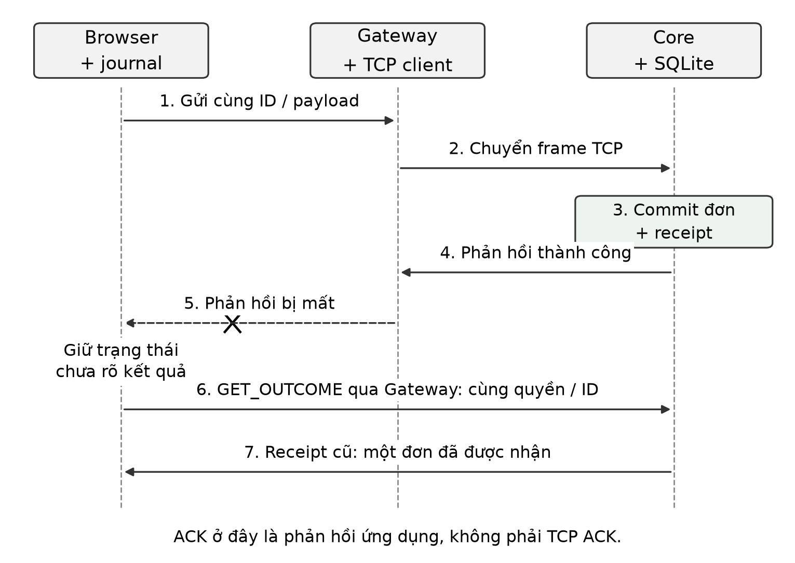

Ở Hình 3, Core đã lưu đơn A nhưng phản hồi bị mất. Client giữ ID của A, lookup lấy lại orderId, không tạo đơn B. Với lời gọi chưa nhận, policy SEMANTIC có thể bỏ ý định ngắn hạn theo quy tắc công khai. Nếu khách vẫn cần, khách gọi mới; hệ thống không tự suy nhu cầu thực từ thời gian offline.

```text
reconcile(intent):
  kiểm quyền, scope và fingerprint; giữ nguyên ID/payload
  known = GET_OUTCOME(intent.id)
  nếu có kết quả: kiểm khớp rồi ghi journal và kết thúc
  nếu còn quyền scope cũ nhưng lượt đã hết: DISCARD bền
  nếu CALL_SERVICE hoặc AMEND_SERVICE: DISCARD bền
  nếu PLACE_ORDER hoặc CANCEL_SERVICE: chờ quyết định
  khi khách xác nhận: lookup lại trước khi gửi cùng ID
  khi khách bỏ: DISCARD; accept trước thì giữ kết quả cũ
  chưa đủ thông tin hoặc ghi journal lỗi: tiếp tục đối chiếu
```

Mã giả mô tả policy SEMANTIC của luồng khách, không bỏ qua guard thực tế trong source. `REQUEST_CHECKOUT` còn ở đường tương thích của hệ thống, không phải tên thay thế cho thanh toán trả trước theo từng đơn trong luồng QR hiện tại. Campaign phục hồi tám scenario tập trung vào PLACE_ORDER/CALL_SERVICE; việc code có thêm AMEND_SERVICE/CANCEL_SERVICE không có nghĩa campaign đã đo riêng mọi nhánh đó.

Khóa tra receipt là cặp `(principal, command_id)`. Principal được Core xác định từ tài khoản quản lý hoặc membership của khách; không lấy từ trường role tự khai. Fingerprint ràng buộc action/payload với ID. Trong DB, `command_receipts` lưu kết quả hoặc dấu bỏ, còn scope xác định ai có quyền đối chiếu. Liên kết principal là khóa logic ứng dụng, không phải một foreign key đa hình tới mọi loại danh tính (CafeLink, 2026b).

## 5. Kiến trúc hệ thống

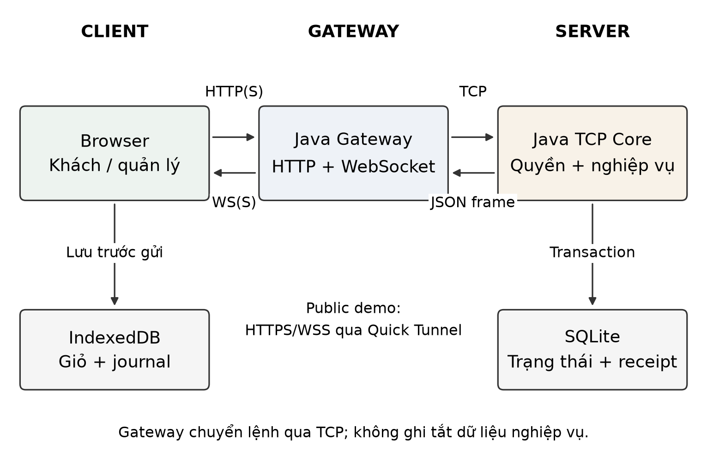

Browser dùng HTTP/HTTPS cho API, WS/WSS cho snapshot. `WebGateway` phục vụ assets/media và kiểm cookie, Origin, CSRF; `SessionBridge` gắn identity web với TCP Client. `CafeServer` nhận frame, chuyển `CafeService`; Core kiểm quyền, giá, scope, version rồi thao tác SQLite. Gateway không sửa tắt DB để bỏ qua TCP.

Reader pool tối đa 64 và outbound queue 64 message/peer là giới hạn cấu hình. Writer riêng gửi socket; queue đầy dẫn tới đóng peer chậm, không giữ khóa service trong lúc chờ ghi bytes. Service đồng bộ giúp kiểm trạng thái/transaction nhất quán nhưng có thể là nút thắt tải. Gateway chia sẻ tổng 32 bridge, trong đó guest tối đa 30 và admin tối đa 16; đây không phải kết quả đo công suất.

`CafeService.execute`, `outcome` và `discard` dùng `synchronized` để bảo vệ trạng thái dùng chung trong tiến trình Core. Mutation kiểm guard rồi lưu thay đổi nghiệp vụ và receipt trong transaction; lệnh tranh chấp cùng ID phải quan sát quyết định đã chốt. Nhiều socket vẫn được đọc đồng thời, nhưng điều đó không có nghĩa mọi mutation DB chạy song song. WAL cũng không thay thế khóa của service.

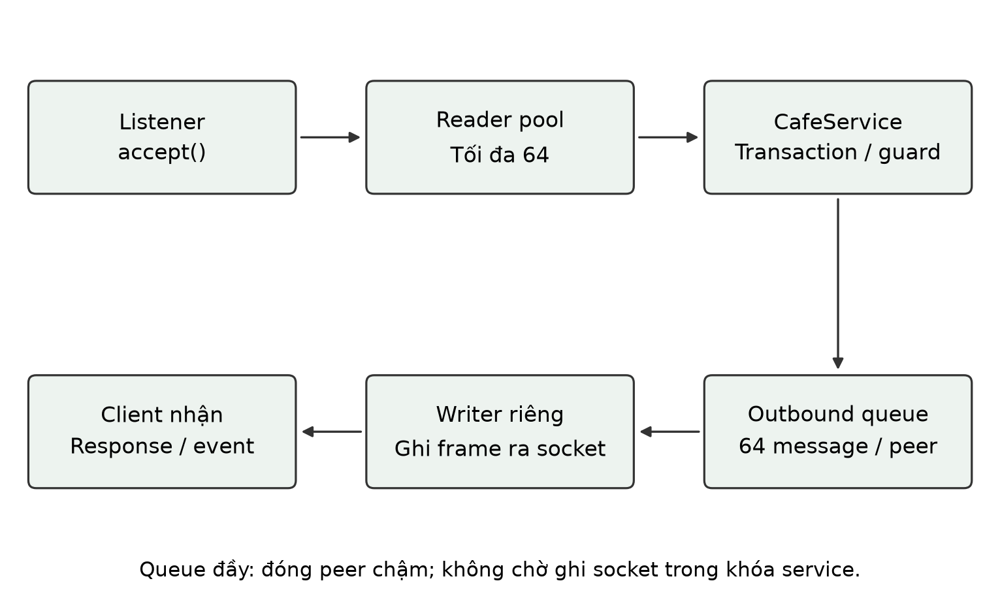

Hình 5 thể hiện ranh giới reader, service và writer. Web Locks ở Browser phối hợp các tab **dùng chung vùng lưu trữ trong trình duyệt**; synchronized ở Core bảo vệ trạng thái **giữa nhiều kết nối**. Hai khóa ở hai máy/lớp khác nhau, không hợp thành transaction phân tán. Bridge/connection nhàn rỗi có thể được thu hồi để giải phóng tài nguyên, nhưng credential/receipt và nghĩa vụ đã nhận không bị xóa theo số connection.

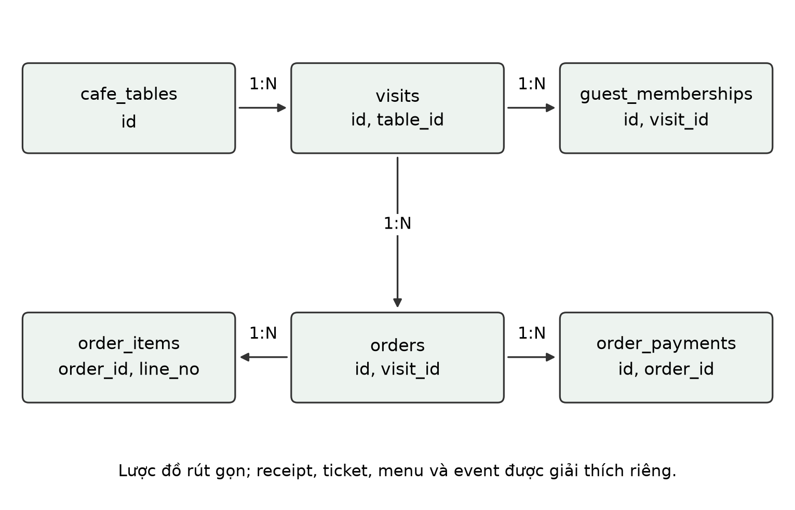

Quan hệ ở Hình 6 tách bàn, visit, membership, đơn, dòng món và giao dịch. Khóa ngoại SQLite được bật (SQLite, không năm-a); `order_items` dùng `(order_id,line_no)`. Receipt, event, menu và ticket là các nhóm dữ liệu riêng. Không dùng số connection hiện tại để xóa dữ liệu của khách đang có nghĩa vụ.

Public demo đặt Quick Tunnel HTTPS trước Gateway loopback; TCP Core vẫn bind loopback. Cloudflare mô tả Quick Tunnel phục vụ thử nghiệm/phát triển (Cloudflare, không năm). Hostname đổi tạo origin mới, nên cookie/IndexedDB không tự chuyển. Public demo không chứng minh uptime production.

## 6. Thiết kế giao tiếp mạng

### 6.1. Frame và envelope

Frame có header bốn byte big-endian biểu diễn độ dài body UTF-8 JSON, hợp lệ 1–262144 byte. Độ dài tính bằng byte, không phải số ký tự tiếng Việt. `FrameCodec` đọc đủ header, kiểm length trước cấp phát, đọc đủ body rồi decode/validate. `DataInputStream.readFully` hỗ trợ việc đọc đầy (Oracle, không năm); một lần read không được coi là một message.

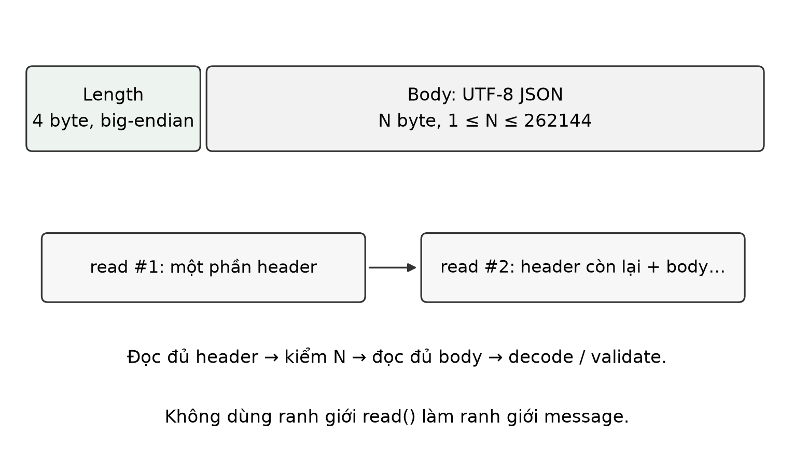

```json
{"version":1,"kind":"REQUEST","requestId":"demo-intent-001",
 "action":"PLACE_ORDER","ok":true,
 "data":{"visitId":"demo-visit","items":[{"menuId":2,"quantity":1,
 "expectedPurchaseVersion":1,"expectedPriceVnd":30000,"note":"Ít đá"}]}}
```

Ví dụ minh họa format, không phải credential thật. RESPONSE giữ correlation ID/action; lỗi có mã/thông điệp. EVENT `STATE_UPDATED` mang snapshot/revision. Gateway chuyển commandId web sang requestId tương ứng; retry mutation giữ nguyên ID. Codec kiểm version/kind/UTF-8/JSON, không dùng Java object deserialization hoặc magic/CRC16 của đề tài IoT mẫu.

Bảng: Trường trong envelope TCP và trách nhiệm kiểm tra

| Trường | Ý nghĩa | Điều kiện/cách sử dụng |
|---|---|---|
| version | Phiên bản envelope, hiện là 1 | Codec kiểm trước khi chuyển nghiệp vụ |
| kind | REQUEST, RESPONSE hoặc EVENT | Phân biệt lệnh, kết quả RPC và cập nhật chủ động |
| requestId | Correlation của request/response | Mutation retry giữ ID ý định; event không gắn một RPC |
| action | Tên thao tác hoặc loại event | Ví dụ PLACE_ORDER, GET_OUTCOME, STATE_UPDATED |
| data | Object JSON của action | Core tiếp tục kiểm scope, kiểu dữ liệu và guard nghiệp vụ |
| ok | Kết quả xử lý của response | Không suy thành công từ việc socket đã kết nối |
| errorCode, message | Mã lỗi và giải thích khi ok=false | Client chọn hành động tiếp theo, không đổi payload của ID đã phát |

Ba ví dụ dưới minh họa hình dạng response/event theo `Message.java`; ID, số đơn, revision và số tiền là dữ liệu giải thích, không phải log thực nghiệm. Request/response thành công của đơn có thể là:

```json
{"version":1,"kind":"RESPONSE","requestId":"demo-intent-001",
 "action":"PLACE_ORDER","ok":true,
 "data":{"orderId":42,"totalVnd":30000,"paymentRequired":true}}
```

Một phản hồi lỗi vẫn giữ requestId/action để Client đối chiếu đúng lệnh:

```json
{"version":1,"kind":"RESPONSE","requestId":"demo-intent-001",
 "action":"PLACE_ORDER","ok":false,"errorCode":"COMMAND_CONFLICT",
 "message":"Mã yêu cầu đã dùng cho nội dung khác.","data":{}}
```

Event là cập nhật trạng thái được lọc quyền. Ví dụ snapshot rỗng để minh họa đầy đủ các nhóm trường, không biểu diễn đơn #42 ở ví dụ trước:

```json
{"version":1,"kind":"EVENT","action":"STATE_UPDATED","ok":true,
 "data":{"revision":7,"menu":[],"tables":[],"orders":[],"tickets":[],
 "checkouts":[],"resolutions":[],"storeAcceptingOrders":true}}
```

HTTP command thêm `scope` và `commandId` trong body; Gateway kiểm cookie/Origin/CSRF, chuyển ID nghiệp vụ thành requestId TCP rồi trả kết quả. Không dùng ID của một lần lookup GET_OUTCOME làm ID mới cho đơn đang phục hồi. Trường `found=false` của lookup chỉ nói chưa có receipt tại lúc đọc, không chứng minh lệnh gốc không thể tới sau.

### 6.2. Connection và cập nhật trạng thái

Gateway thiết lập TCP rồi xác thực/join/resume trước lệnh cần quyền, tái sử dụng connection cho response/event. Browser có cookie phiên và kênh WS; mất WS không xóa receipt Core. Snapshot lọc quyền, Client bỏ revision cũ. Feed thông báo có cursor đọc riêng; đọc thông báo không hoàn tất order/ticket.

Browser timeout HTTP sau 8 giây; Core có socket read timeout 60 giây. Hai mốc ở hai lớp khác nhau: Browser có thể ngừng chờ khi Core đã commit. Khi peer đóng, writer/socket được kết thúc và connection bị loại; dữ liệu đã commit vẫn ở DB. Reconnect chỉ khôi phục session/state, không tự phát một PLACE_ORDER mới.

### 6.3. Luồng đặt món và trả trước bình thường

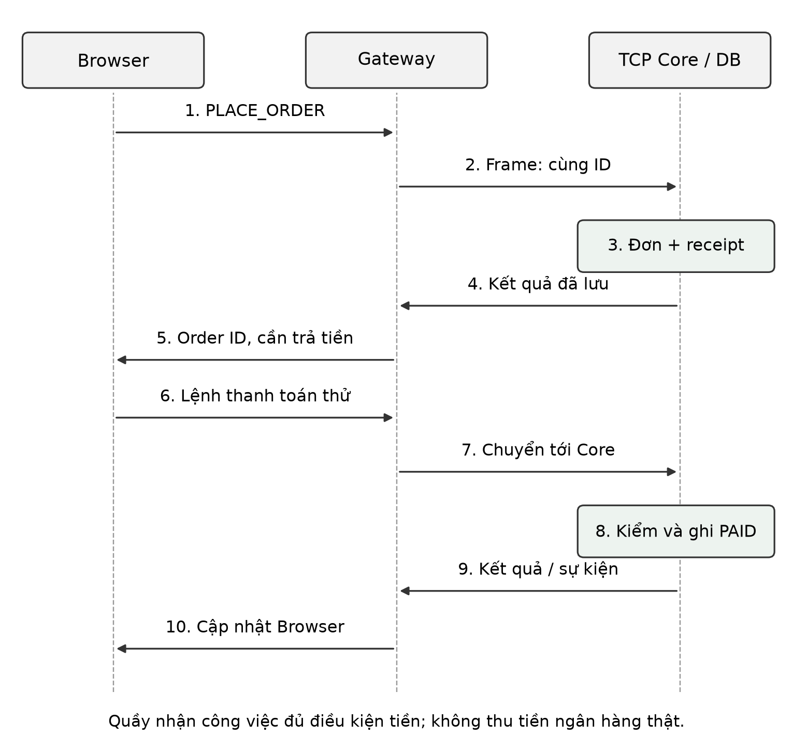

Sau khi khách xác nhận giỏ, PLACE_ORDER qua Gateway tới Core, nơi giá/version được kiểm và đơn cùng receipt được ghi. Phản hồi có orderId, tổng tiền và điều kiện cần trả trước. Tiếp theo Browser gửi START_ORDER_PAYMENT cho đúng visit/order; Core trả giao dịch simulator. Kết quả thanh toán thử được đưa về Core qua SIMULATE_PAYMENT, kiểm trước khi cập nhật PAID và phát trạng thái mới. Quầy chỉ được bắt đầu pha chế khi guard tiền cho phép, rồi chuyển PREPARING → READY → SERVED.

Hình 8 tách hai lần tiếp nhận khác nhau: đặt món thành công chưa đồng nghĩa đã thanh toán, và PAID chưa đồng nghĩa giao đủ đồ. Khi khách bấm trả lại, giao dịch PENDING còn phù hợp được tái sử dụng; giao dịch có hạn 15 phút. Kết quả simulator lặp không tạo thêm khoản PAID. Số tiền/đơn và payload demo được kiểm ở Core; chữ ký của cơ chế giả lập không trở thành xác nhận từ ngân hàng. Thất bại/hủy/hết hạn cần dựa trên trạng thái hiện có để thử lại, không đánh dấu đơn là đã trả chỉ vì Browser mở được trang thanh toán.

### 6.4. Lỗi và bảo vệ dữ liệu

Bảng: Nhóm lỗi, phản ứng và trạng thái cần giữ

| Nhóm | Ví dụ | Phản ứng hợp lý |
|---|---|---|
| Mạng hoặc timeout | Không có phản hồi, Gateway mất Core | Giữ mã/payload, hiển thị chưa rõ kết quả và đối chiếu |
| Xác thực/phạm vi | UNAUTHENTICATED, SCOPE_CHANGED | Khóa gửi bằng quyền không phù hợp; không nhập lệnh cũ vào phiên mới |
| Menu thay đổi | MENU_CHANGED, ITEM_UNAVAILABLE | Cho khách xem lại giỏ/giá; không âm thầm nhận một điều kiện mua khác |
| Trạng thái/version | INVALID_STATE, VERSION_CONFLICT | Đọc lại trạng thái, tránh cập nhật đè phần thay đổi của người khác |
| ID bị dùng khác nội dung | COMMAND_CONFLICT | Giữ thông tin hỗ trợ, không sửa payload của ID đã phát |
| Lệnh đã bỏ | COMMAND_DISCARDED | Không tạo tác dụng mới; phân biệt với hủy một đơn đã nhận |
| Database | DATABASE_ERROR | Không báo thành công; kiểm trạng thái trước retry |

API JSON giới hạn 64 KiB. Ảnh menu tối đa 2 MiB đi qua HTTP và được kiểm/re-encode, không nhúng vào frame TCP. Admin dùng hash mật khẩu/salt; guest dùng quyền membership từ QR. Cookie HttpOnly/SameSite, public thêm Secure, kiểm Origin/CSRF. HTTPS/WSS thuộc tunnel; đường TCP Core loopback không phải TLS do nhóm triển khai. Các guard đã có test nhưng không thay kiểm toán an toàn production.

## 7. Triển khai

Bảng: Module triển khai và trách nhiệm

| Thành phần | Tệp/module tiêu biểu | Trách nhiệm |
|---|---|---|
| Protocol | `FrameCodec`, `Message`, `Commands`, `Models` | Framing, dữ liệu, phân loại mutation và correlation |
| TCP/DB | `CafeServer`, `CafeService`, `Database` | Nhiều connection, đồng bộ trạng thái, transaction/schema |
| QR/phiên | `QrAccess`, `TableOrdering` | Quyền gia nhập, private visit, auto complete, continuation |
| Món/tiền/hỗ trợ | `MenuCatalog`, `OrderPayments`, `OrderResolutions`, `SupportActions` | Version mua hàng, thanh toán/hoàn giả lập, ticket version/audit |
| Gateway | `WebGateway`, `SessionBridge` | API/WS, bridge/lease, proxy, media |
| Browser | `journal`, `orderRecovery`, `GuestWorkspace`, `staffJournal` | Write-before-send, phục hồi, giữ giỏ và thao tác tiền của quầy |
| Kiểm chứng | `web/experiments`, `web_oracle.py`, `analyze_web.py` | Fault có kiểm soát, policy comparison, tải và oracle read-only |

Maven target 17, gói JRE 17 giúp chạy demo không cần cài JDK/Node. React/TypeScript tạo website; IndexedDB giữ journal và Web Locks phối hợp các tab. SQLite schema 11 lưu bền, giữ receipt gốc và lịch sử xử lý tiền/hỗ trợ. Sao lưu khi đang ghi cần xét WAL; chỉ sao chép tệp `.db` có thể bỏ sót trạng thái chưa checkpoint (SQLite, không năm-b).

Bảng: Thư viện chính và vai trò trong implementation

| Thành phần | Lựa chọn trong source | Trách nhiệm |
|---|---|---|
| HTTP/WebSocket | Jetty | Phục vụ website/API và kênh push ở Gateway; không thay Core kiểm nghiệp vụ |
| JSON | Gson | Serialize/parse envelope và dữ liệu có cấu trúc |
| Lưu trữ Java | SQLite JDBC | Truy cập SQLite, transaction, receipt, schema và lịch sử |
| Frontend | React, TypeScript, Vite | Component UI, kiểm kiểu và build tài nguyên Browser |
| Kiểm Java/Browser | JUnit, Playwright | Kiểm service/protocol và điều khiển Chromium chạy luồng web |
| Đối chiếu dữ liệu | Python, sqlite3 | Oracle đọc DB và analyzer tính chỉ số từ raw |

Dependency Java được khai báo trong `pom.xml`, dependency web được cố định bằng `package-lock.json`. Compiler target 17 là mức tương thích bytecode; environment của run ghi JDK 24.0.2, còn gói portable chứa JRE 17. Ba thông tin này được giữ riêng để tái lập, không dùng tên phiên bản đóng gói thay bằng chứng về runtime.

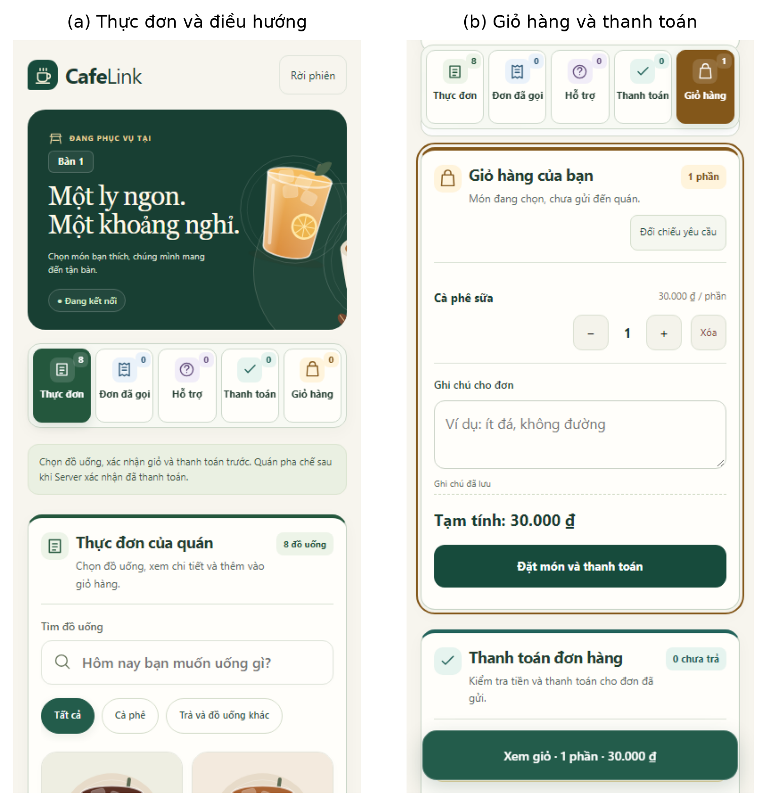

Màn khách tách thực đơn, đơn đã gọi, hỗ trợ, thanh toán và giỏ hàng; điều hướng không phát mutation hoặc làm mất nháp. Menu có ảnh, giá và trạng thái bán. Quầy tách công việc pha chế, hỗ trợ và lịch sử tiền; âm thanh cần người dùng kích hoạt theo chính sách browser. Ảnh ở Hình 9 và Hình 10 lấy từ ca Chromium, chưa thay trải nghiệm điện thoại/quầy thật.

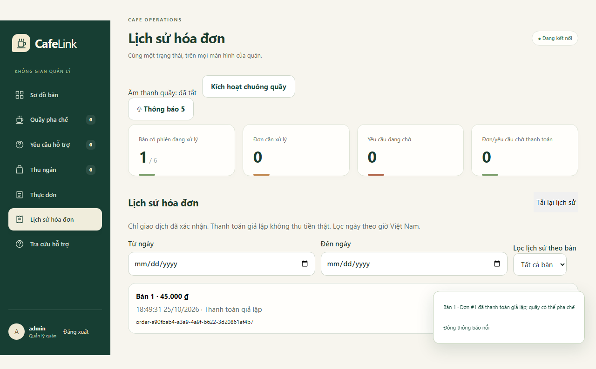

UI giảm thao tác nhầm, còn Core giữ guard cuối cùng. Cùng ý định trả thử đang PENDING được dùng lại thay vì tạo thêm khoản thu. Simulator có thành công/thất bại/hủy và hết hạn; trạng thái PAID vẫn cần quầy phục vụ. Đổi màu, thêm ảnh hoặc QR được xem là hoàn thiện sản phẩm, không thay contribution kỹ thuật.

## 8. Thiết lập thực nghiệm

### 8.1. Môi trường và dữ liệu

Bảng: Môi trường thực nghiệm

| Thành phần | Thông tin thực tế |
|---|---|
| OS | Microsoft Windows NT 10.0.26200.0 |
| CPU | 12th Gen Intel(R) Core(TM) i7-12700H |
| RAM / logical processors | 16.907.980.800 byte / 20 |
| Java | JDK 24.0.2, target 17; gói runtime JRE 17 |
| Node / Python | v22.20.0 / Python 3.13.6 |
| Topology | Một host; browser → Gateway → TCP Core → SQLite qua loopback |
| Dữ liệu / payment | Sáu bàn, tám món seed, private visits; LOCAL_SIMULATOR |
| Seed / lặp | 20261023; recovery 5 lần, tải 3 lần/mức |

Số liệu được ghi ngày 25/10/2026 cho V9.3/schema 11, từ run `20261025-final-r2`. Browser, Gateway, Core và SQLite chạy cùng host qua loopback. JAR và manifest được định danh trong [environment/hash](evidence/cafelink-final/20261025-final-r2/environment.json). Bản experiment thêm harness vào assets riêng; runtime chính không phục vụ experiment.html. Fixture dùng sáu bàn/tám món và thanh toán giả lập, không chứa dữ liệu khách thật. Lần biên tập ngày 29/10/2026 sử dụng lại dữ liệu này, không chạy thí nghiệm mới; run lỗi trước đó được giữ ở Phụ lục C.

### 8.2. Đối chứng và ranh giới lỗi

Phép đo tải cho biết pipeline phản hồi ra sao nhưng không tự chứng minh ý định được xử lý đúng. Vì vậy, nhóm đánh giá riêng phục hồi chức năng và tải. Fault trước forward/sau commit tách hai tình huống ở phần Giới thiệu; oracle DB kiểm tác dụng thực tế. Giữ chung Core và guard giúp đối chiếu quyết định phục hồi, thay vì tạo lợi thế bằng cách bỏ chống trùng ở baseline.

R0 REPLAY_ALL gửi lại cùng ID/payload chưa rõ. R1 REVIEW lookup rồi chờ khách với ý định chưa nhận, không tự đặt discard barrier. R2 SEMANTIC lookup và quyết định theo loại/scope. Cả ba dùng chung idempotency, fingerprint, quyền và guard phiên; baseline không bị cố tình bỏ chống trùng.

Bảng: Kịch bản phục hồi và oracle

| Kịch bản | Ranh giới lỗi/lịch | Oracle |
|---|---|---|
| NORMAL_ORDER | Không lỗi | Một đơn đúng |
| LOST_ORDER_ACK | Forward thành công, bỏ response sau commit | Một đơn, lấy receipt cũ |
| UNACCEPTED_ORDER | Abort trước forward | R0 tự gửi; R1/R2 chưa đặt trước xác nhận |
| UNACCEPTED_SERVICE | Chưa nhận, quy định nhu cầu đã hết | Đếm ticket ngoài nhu cầu đã quy định |
| LOST_SERVICE_ACK_HANDLED | Đã nhận, mất response, quầy xử lý | Một ticket đã xử lý, không sinh lại |
| VISIT_ENDED | Lượt cũ đóng, khách khác quét cùng QR | Không tác dụng sang visit mới |
| DISCARD_WINS_LATE_SERVICE | Đối chiếu/bỏ trước khi giao lệnh cũ | R2 có barrier, lệnh cũ không tạo ticket |
| ACCEPT_WINS_LATE_SERVICE | Accept/xử lý trước đối chiếu | Không discard ngược kết quả đã nhận |

Tám kịch bản × ba policy × năm lần = 120 ca. LOST_ORDER_ACK bỏ phản hồi ứng dụng sau commit; UNACCEPTED_ORDER chặn trước forward. Hai lịch discard-wins/accept-wins điều khiển thứ tự để kiểm barrier. Đây không phải đo packet loss TCP hoặc chỉ bật Network Offline ngẫu nhiên. Trong hai ca lời gọi cũ, nhu cầu được quy định đã hết; đó là giả định thiết kế thí nghiệm, chưa phải khảo sát hành vi khách.

Các case được trộn theo seed 20261023. Mỗi case gia nhập bằng browser context/private visit riêng; fixture Server được làm mới theo batch 12 case để giữ điều kiện giới hạn tài nguyên/rate. Cách này tránh dùng sót journal/quyền của case trước làm điều kiện ban đầu. Teardown ghi nhận lỗi riêng, không sửa kết quả đo thành thành công.

`campaign.mjs` quan sát fault đúng một lần ở ranh giới đã định nghĩa rồi mới chạy đối chiếu. Với after-commit, request được forward và xử lý thật trước khi Browser không nhận phản hồi; với before-forward, Core chưa được nhận lệnh tại điểm chặn. Hai lịch giao muộn chủ động đặt thứ tự accept/discard. Chúng kiểm các interleaving quan trọng đã chọn, không chứng minh đã duyệt hết mọi lịch thread, NAT hoặc proxy thực tế.

### 8.3. Workload và metric

Tải dùng 1/5/10/14 guest, ba lượt mỗi mức, warmup 3 giây và cửa sổ đo 15 giây. Mỗi guest phát tối đa một flow/giây; flow nối tiếp gồm đặt món và trả thử. Slot không kịp phát được ghi missedSlots. Oracle đọc DB kiểm đơn, tiền và scope; không chỉ dùng HTTP 200 làm bằng chứng đúng.

`recoveryMs` đo từ lúc bắt đầu lấy session để đối chiếu đến khi đọc lại journal/state; không gồm thời gian người dùng cân nhắc xác nhận. p50/p95 phục hồi tính trên 40 thời lượng ca của mỗi policy. `responseMs` đo từ đầu thao tác tải đến khi Client đọc được receipt đặt món đã ghi journal, gồm session/state và IndexedDB; bước thanh toán diễn ra sau thời điểm này. Do đó, p95 response trong bảng tải là p95 phản hồi đặt món, không phải độ trễ TCP hoặc toàn bộ flow đặt món–trả tiền. Hai ranh giới timer nằm trong `harness.ts` (CafeLink, 2026b).

Mỗi flow tiếp tục trả thử sau khi có đơn; throughput đếm flow hoàn tất trong cửa sổ đo thực. p50/p95 dùng nearest rank trên mẫu hợp lệ. `renderMs` phát hiện DOM sau khi biết ID, có thể là cận trên nếu push đã đến trước. Số mẫu HTTP được thống kê riêng với số ca/flow; HTTP bytes chỉ tính body giải mã, chưa gồm header/TCP/TLS/WS/retransmission.

Khi đo, campaign chạy riêng; seed, raw, CSV, environment và oracle được lưu theo run để đối chiếu.

### 8.4. Dữ liệu cố định, oracle và tính tái lập

Mỗi flow tải chọn món ID 2 trong menu seed, một phần cà phê sữa giá 30.000đ, rồi trả thử thành công. Dataset là dữ liệu do harness sinh, không phải lịch sử bán hàng ngoài quán. Cố định món/số lượng giúp oracle kiểm order, payment PAID và tổng tiền tương ứng. Các flow warmup vẫn ghi DB dù bị loại khỏi cửa sổ tính latency/throughput; vì vậy tổng 1.618 đơn/payment trong oracle khác 1.348 flow được đo.

`web_oracle.py` mở SQLite bằng `mode=ro`, chọn allowlist các cột order/ticket/receipt/event/payment theo visit/membership. Oracle không phát một phản hồi giả, sửa DB hoặc cấp quyền để làm ca kiểm đạt. Với C2, campaign kiểm thêm receipt có `cancelledBeforeAcceptance` ở các ca R2 bỏ trước tiếp nhận, thay vì chỉ nhìn số ticket bằng 0. Các lỗi policy/assertion vẫn giữ bản quan sát oracle để phân tích sau.

Với n mẫu thời gian hợp lệ đã sắp tăng dần, nearest-rank chọn phần tử ở vị trí ceil(p × n); p95 dùng p=0,95. Throughput của một lượt là số flow hoàn tất chia cho cửa sổ đo thực tính bằng giây. Không đổi thiếu mẫu thành 0 hoặc lấy trung bình ba p95 rồi gọi là p95 chung. Slot lỡ thuộc lịch nguồn phát, không phải một HTTP request đã gửi rồi lỗi; báo cáo giữ cả hai loại thông tin.

Tái lập cần đúng source/JAR/assets và môi trường ghi trong manifest, output mới, cổng test trống, các giới hạn sản phẩm được giữ và không có campaign khác chạy chồng. Lần chạy trên máy khác không cần trùng từng mili giây; điều cần tái lập là cách tạo case, invariant, ranh giới đo và cách tính. Raw, CSV, analysis và environment phải đi cùng nhau để người đọc kiểm lại phép tổng hợp.

### 8.5. Liên kết câu hỏi nghiên cứu và bằng chứng

Bảng dưới xác định phép kiểm nào trả lời từng phần của RQ. RQ1a/RQ1b là hai khía cạnh của RQ1, tương ứng C1/C2; không phải hai nghiên cứu độc lập.

Bảng: Câu hỏi nghiên cứu, phép đánh giá và bằng chứng

| Câu hỏi | Cách đánh giá | Dữ liệu để trả lời | Phạm vi kết luận |
|---|---|---|---|
| RQ1a / C1: xử lý ý định chưa nhận | So R0/R1/R2 khi chưa nhận đơn hoặc lời gọi | Số đơn, lời gọi và ý định chờ, mục 9.2–9.3 | Quyết định có phù hợp giả định nhu cầu của ca kiểm; chưa đo hài lòng của khách |
| RQ1b / C2: lệnh giao muộn | Điều khiển bỏ-trước và nhận-trước; kiểm receipt và DB | Ticket và receipt có dấu bỏ, mục 9.3 | Chặn tác dụng mới khi bỏ thắng; giữ kết quả khi nhận thắng; chưa kiểm hết interleaving |
| RQ2: phản hồi dưới tải | Tăng 1/5/10/14 guest, ba lượt mỗi mức | p95, throughput, lỗi và missedSlots, mục 9.4 | Mô tả cấu hình/workload trên loopback; chưa xác định công suất cực đại |

Số liệu policy là kết quả của từng phương án tích hợp. Các ca lựa chọn giúp giải thích vai trò C1/C2, nhưng chưa có thí nghiệm loại từng thành phần (ablation) để tách riêng hiệu quả và chi phí của mỗi cơ chế.

## 9. Kết quả

### 9.1. Kiểm thử phần mềm và gói chạy

Bảng: Kết quả kiểm thử tự động

| Lớp kiểm | Kết quả ghi nhận | Phạm vi |
|---|---|---|
| Java V9.3 | 142 PASS, 0 failure/error/skip | Core/Gateway/TCP/SQLite/migration và hồi quy desktop |
| Chromium V9.3 | 65 PASS, 0 unexpected/flaky/skip | UI thật, QR, năm vùng, journal/recovery, tiền/hỗ trợ/continuation |
| Gói pristine JRE 17 | 21 nhóm PASS | Không dùng JDK/Node trong PATH app con, integrity, dữ liệu, QR/phiên, nghiệp vụ |
| Bộ phân tích | 3 test PASS | Percentile, mẫu không hợp lệ, không đổi run thiếu/lỗi thành PASS |
| Barrier khởi động driver | PASS | Driver cũ bị khóa; driver mới đợi UI sẵn sàng rồi thực hiện đúng một đơn PAID |
| Source sạch | 142 Java + 65 Chromium PASS | Thư mục có khoảng trắng; frontend và bytecode khớp V9.3 đã đóng gói |
| Public Chromium bản chốt | 7 kiểm PASS, launcher dừng sạch | HTTPS/WSS/QR/private orders/payment; không thay nghiệm thu điện thoại |

Chi tiết: [gate Java/Chromium](evidence/cafelink-v2/v9.3-gate/20261025-184703-1bdff3d4/summary.json), [gói pristine](evidence/cafelink-v2/v9.3-package/20261025-release-01/summary.json), [source sạch](evidence/cafelink-final/source-clean/source-proof.json), [public](evidence/cafelink-final/public-final/public-package.json). CI công khai thành công cho commit e059123 (CafeLink, 2026a); không xác nhận các chỉnh sửa báo cáo chưa push hoặc điện thoại thật.

### 9.2. So sánh phục hồi

Bảng: So sánh ba chính sách phục hồi

| Chỉ số trong tập ca | R0 REPLAY_ALL | R1 REVIEW | R2 SEMANTIC |
|---|---|---|---|
| Đơn trùng | 0 | 0 | 0 |
| Đơn tự gửi trước xác nhận | 5 | 0 | 0 |
| Ticket khi giả định hết nhu cầu | 10 | 5 | 0 |
| Tác dụng sai lượt | 0 | 0 | 0 |
| Ý định chờ quyết định | 0 | 15 | 5 |
| p50 đối chiếu, ms | 24,30 | 23,10 | 25,40 |
| p95 đối chiếu, ms | 37,20 | 28,60 | 37,00 |

Mỗi policy có 40 ca. Cả ba không sinh đơn trùng/sai lượt trong tập ca vì giữ chung guard nền. Khác biệt nằm ở 5 đơn R0 tự gửi trước xác nhận, số ticket ngoài nhu cầu quy định 10/5/0, và số ý định chờ quyết định 0/15/5. R2 không được ghi công riêng cho toàn bộ lợi ích chống trùng hoặc scope của baseline.

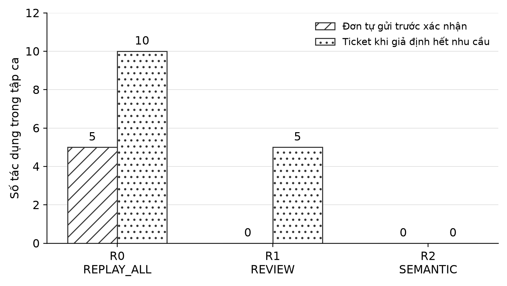

So với R1, R2 giảm số lời gọi ngoài nhu cầu quy định từ 5 xuống 0 và số ý định chờ xác nhận từ 15 xuống 5 trên cùng tập kịch bản. p95 đối chiếu trên 40 ca mỗi policy lần lượt là 37,00 ms với R2 và 28,60 ms với R1; số mẫu HTTP phát sinh tương ứng là 250 và 235. Hai loại mẫu được đếm riêng. R2 vì thế giảm việc thừa theo giả định của ca kiểm nhưng không cho kết quả đối chiếu nhanh hơn R1 trong run này. Việc giảm lời nhắc phụ thuộc quán chấp nhận quy tắc bỏ lời gọi ngắn hạn chưa nhận.

### 9.3. Kết quả từng kịch bản và bằng chứng barrier

Bảng: Đối chiếu từng kịch bản trên năm lần lặp mỗi policy

| Kịch bản | R0: O/T/C | R1: O/T/C | R2: O/T/C |
|---|---|---|---|
| NORMAL_ORDER | 5/0/0 | 5/0/0 | 5/0/0 |
| LOST_ORDER_ACK | 5/0/0 | 5/0/0 | 5/0/0 |
| UNACCEPTED_ORDER | 5/0/0 | 0/0/5 | 0/0/5 |
| UNACCEPTED_SERVICE | 0/5/0 | 0/0/5 | 0/0/0 |
| LOST_SERVICE_ACK_HANDLED | 0/5/0 | 0/5/0 | 0/5/0 |
| VISIT_ENDED | 0/0/0 | 0/0/0 | 0/0/0 |
| DISCARD_WINS_LATE_SERVICE | 0/5/0 | 0/5/5 | 0/0/0 |
| ACCEPT_WINS_LATE_SERVICE | 0/5/0 | 0/5/0 | 0/5/0 |

O/T/C trong bảng lần lượt là số order, ticket và ý định cần xác nhận, cộng qua **năm ca mỗi policy**. Các cột không phải tỷ lệ phần trăm; năm ticket ở một ô là tổng của năm ca độc lập.

Nguồn kiểm lại từng ô: [raw recovery](evidence/cafelink-final/20261025-final-r2/recovery/results.json). Các file oracle đi kèm quan sát dữ liệu thật sau từng case; kết quả PASS của harness không thay nội dung quan sát này.

NORMAL_ORDER và LOST_ORDER_ACK giữ năm order ở cả ba policy: mỗi case có một đơn, kể cả khi response sau commit bị mất. Đây là điều kiện đúng nền do idempotency chung, không phân biệt riêng lợi ích R2. UNACCEPTED_ORDER cho R0 năm order, R1/R2 không có order nhưng giữ năm ý định chờ quyết định. Trạng thái chờ là kết quả mong muốn của ca này, không phải mất đơn.

Với DISCARD_WINS_LATE_SERVICE, R0/R1/R2 có lần lượt **5/5/0 ticket**. Lệnh gốc được giao sau đối chiếu; R1 còn giữ năm ý định chờ, nhưng review không tự đặt barrier nên lệnh muộn vẫn có tác dụng. R2 đã lưu quyết định bỏ tại Core nên không tạo ticket mới. UNACCEPTED_SERVICE kiểm phía đơn giản hơn: chưa có kết quả và nhu cầu được quy định hết; R2 bỏ, còn R1 giữ quyết định cho người dùng.

Ngược lại, ACCEPT_WINS_LATE_SERVICE giữ **5/5/5 ticket**: công việc đã được Core tiếp nhận và xử lý trước đối chiếu. Cả ba policy phải bảo toàn kết quả đó. Nếu R2 xóa ngược ticket để có số đếm thấp hơn, cơ chế sẽ sai. C2 vì vậy gồm cả chặn tác dụng mới khi discard thắng và giữ kết quả cũ khi accept thắng.

VISIT_ENDED có 0 tác dụng sang lượt mới ở cả ba policy do guard scope chung. Barrier của R2 tích hợp với ranh giới này, nhưng không lấy riêng kết quả 0 để khẳng định baseline thiếu bảo vệ phiên. Hai lịch barrier là bằng chứng cho C2 trong điều kiện được chọn; chúng không phải kiểm toàn bộ interleaving hoặc mọi loại command.

### 9.4. Tải gọi món và thanh toán giả lập

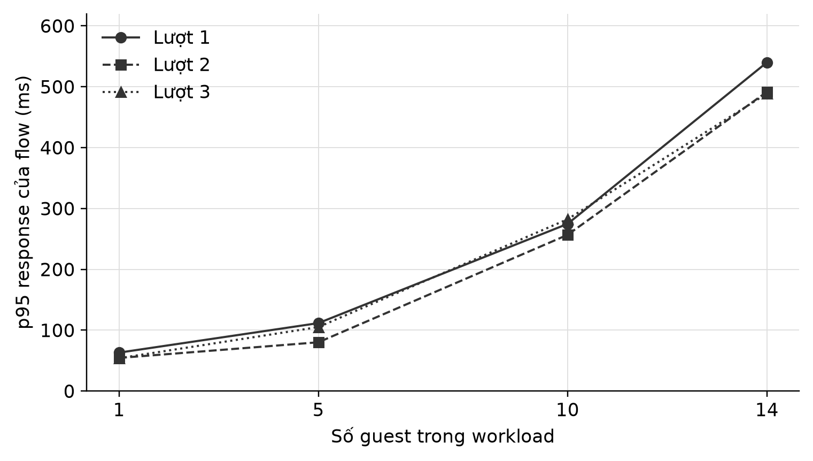

Bảng: Kết quả từng lượt tải

| Guest | Lượt | Flow | p95 đặt món, ms | Slot lỡ | Flow/s |
|---|---|---|---|---|---|
| 1 | 1 | 15 | 63,20 | 0 | 1,00 |
| 5 | 1 | 75 | 111,70 | 0 | 5,00 |
| 10 | 1 | 150 | 274,70 | 0 | 9,99 |
| 14 | 1 | 210 | 540,00 | 0 | 13,93 |
| 1 | 2 | 15 | 54,50 | 0 | 1,00 |
| 5 | 2 | 75 | 80,20 | 0 | 5,00 |
| 10 | 2 | 150 | 256,70 | 0 | 10,00 |
| 14 | 2 | 209 | 491,70 | 1 | 13,90 |
| 1 | 3 | 15 | 54,00 | 0 | 1,00 |
| 5 | 3 | 75 | 105,20 | 0 | 5,00 |
| 10 | 3 | 150 | 282,30 | 0 | 9,99 |
| 14 | 3 | 209 | 488,80 | 1 | 13,91 |

Tổng 1.348/1.350 flow-slot hoàn tất, hai slot lỡ, không flow báo lỗi. Phần tải có 15.635 mẫu HTTP, không HTTP error; tổng body giải mã 31.988.315 byte không phải băng thông trên dây. Oracle kiểm cả warmup: 1.618 đơn và payment PAID, tổng 48.540.000đ giả lập. Số HTTP sample, flow, slot và order gồm warmup là các mẫu số khác nhau.

Khi tăng từ 1 lên 14 guest, p95 phản hồi đặt món tăng từ 54,00–63,20 ms lên 488,80–540,00 ms qua ba lượt; thông lượng ở mức 14 guest đạt 13,90–13,93 flow/s. Hai slot lỡ đều ở mức này. Workload giới hạn một flow/guest/giây và chưa tìm điểm bão hòa, nên bảng mô tả mức tải đã phát chứ chưa xác định công suất tối đa. Giữ riêng p95 từng lượt, không lấy trung bình thành p95 chung.

Dữ liệu gốc: [summary](evidence/cafelink-final/20261025-final-r2/summary.json), [analysis](evidence/cafelink-final/20261025-final-r2/analysis.json), [policy CSV](evidence/cafelink-final/20261025-final-r2/policy-summary.csv), [load CSV](evidence/cafelink-final/20261025-final-r2/load-summary.csv).

## 10. Thảo luận

**Giá trị thực tiễn.** Nếu khách đã đặt một cà phê và quán đã nhận, mất phản hồi chỉ dẫn tới lấy lại đơn đó, thay vì yêu cầu khách đặt lần nữa. Nếu quán chưa nhận, R2 để khách quyết định có tiếp tục mua sau gián đoạn. Với lời gọi ngắn hạn chưa nhận, dấu bỏ ngăn nhân viên bị điều tới bởi lệnh giao muộn. Chỉ xóa nhật ký Client không bảo vệ được khoảng hở giữa lookup và lệnh vẫn trên đường tới Core. Trong thực nghiệm, lợi ích được đo bằng số tác dụng ngoài nhu cầu và số ý định chờ, chưa đo bằng tiền tổn thất, thời gian nhân viên hoặc mức hài lòng.

**Đánh đổi.** R2 cần thêm lookup/transaction và quy tắc rõ cho từng loại lệnh; không phải mọi yêu cầu đều nên bị bỏ. REVIEW phù hợp nếu quán muốn con người xét mọi ý định. Nếu vẫn cần hỗ trợ sau R2 bỏ ý định chưa nhận, khách phát lời gọi mới. Policy không tự suy nhu cầu thật chỉ từ thời gian offline.

**Giới hạn phép đo.** Host chia sẻ CPU giữa browser và Server; workload nhỏ và cố định, chưa tìm bão hòa. p95 tăng ở mức tải cao không cho biết riêng chi phí network, SQLite hay rendering. Chưa profiling CPU/GC/queue hoặc kiểm nhiều điện thoại qua Internet. Không dùng chênh lệch giữa các phiên bản để kết luận tối ưu nào gây cải thiện khi chưa có đối chứng tách thành phần.

**Phạm vi khái quát.** Fault được tạo ở tầng HTTP routing và lịch giao lệnh có kiểm soát, nên không tái hiện mọi đứt TCP, proxy, NAT hoặc tắt nguồn máy. Nhu cầu hỗ trợ được định nghĩa trong kịch bản; chưa có dữ liệu cho rằng mọi khách thực đều hết nhu cầu sau một khoảng offline. Nhánh xử lý rút/bổ sung có trong implementation không đồng nghĩa tám scenario đã đo riêng chúng. Muốn mở rộng claim cần thêm ca tương ứng, không chỉ thêm tên action vào báo cáo.

**Sai lệch công cụ đo.** Driver từng phát lệnh khi UI còn đối chiếu journal, làm warmup thất bại. Phụ lục C nối lỗi quan sát, cách điều chỉnh và lần kiểm lại; run lỗi vẫn được giữ. Vì hai run khác nhau, không lấy chênh lệch độ trễ giữa chúng làm bằng chứng tối ưu hiệu năng.

## 11. Novelty và contributions

Bảng: Đóng góp, phần triển khai và bằng chứng

| Contribution | Phần nhóm thực hiện | Bằng chứng và giới hạn |
|---|---|---|
| C1. Phục hồi theo loại yêu cầu | Journal trước gửi, lookup, giữ xác nhận cho đơn chưa nhận và bỏ lời gọi ngắn hạn chưa nhận theo policy | So sánh R0/R1/R2, ca lost ACK/unaccepted; chỉ kết luận trong giả định/thí nghiệm, không gọi idempotency mới |
| C2. Barrier bền gắn phạm vi phiên | DISCARD tranh chấp cùng transaction với accept; scope store/visit/membership, không chuyển command sang lượt mới | Ca discard-wins/accept-wins/visit-ended; idempotency/scope vẫn được giữ ở baseline, không gán mọi lợi ích cho R2 |
| Giá trị tích hợp bổ trợ | QR/private visit, thanh toán/phục vụ tách trạng thái, ghi chú từng phần, audit và năm vùng UI | Java/E2E/package tests; đây là hoàn thiện hệ thống, không coi đổi màu/QR/UI đơn thuần là novelty |

C1 nằm ở quyết định theo loại yêu cầu, không chỉ gửi lại cùng ID. C2 xử lý race giữa bỏ và nhận bằng dấu bền cùng phạm vi phiên. Các kịch bản lost-response, unaccepted, discard-wins, accept-wins và visit-ended nối hai claim với implementation/experiment. Idempotency, versioning, transaction và fencing là kỹ thuật nền đã biết; contribution là cách tích hợp có thể chạy, đối chứng và kiểm được trong bài toán này.

Để truy vết C1, đọc `orderRecovery.reconcile/resolve/recover` cùng transaction `journal.mark`, rồi đối chiếu UNACCEPTED_ORDER/UNACCEPTED_SERVICE ở mục 9.3. Để truy vết C2, đọc `CafeService.execute/outcome/discard`, khóa principal/command ID và receipt barrier, rồi đối chiếu hai thứ tự giao lệnh. Nơi triển khai, case đo và giới hạn suy luận cùng xác định phạm vi đóng góp; bảng gate PASS không tự thay chứng minh từng claim.

## 12. Hạn chế

Chưa nghiệm thu Android/iOS, camera, trình duyệt trong ứng dụng quét QR, LAN hai máy hoặc usability với khách/quầy thật. Mobile viewport và public Chromium chỉ kiểm phần mềm, không thay nghiệm thu thiết bị. QR bị chia sẻ có thể dùng từ xa; mất cookie/storage không tự lấy lại danh tính từ QR.

Thanh toán/hoàn tiền là giả lập; chưa có merchant/webhook/đối soát ngân hàng. Trạng thái phục vụ áp dụng toàn đơn, chưa giao/hoàn từng phần. Guard tài nguyên không phải SLA. Journal/receipt phụ thuộc storage, origin, scope và retention; không phục hồi dữ liệu bị người dùng xóa hoặc mọi sự cố phần cứng. Các test đã đạt không chứng minh không còn lỗi.

## 13. Hướng phát triển

Ưu tiên nghiệm thu điện thoại/quầy thật và origin ổn định; sau đó profiling, tăng workload và kiểm lỗi mạng dài hơn. Tích hợp ngân hàng cần xác nhận phía Server cùng đối soát. Thay mô hình concurrency hoặc tối ưu queue chỉ nên làm khi phép đo chỉ ra nút thắt, tránh tăng độ phức tạp mà chưa có lợi ích kiểm chứng.

Nghiệm thu trải nghiệm cần quan sát cả khách và quầy: khách quét QR, sửa giỏ, đặt/trả thử và hiểu trạng thái sau lỗi; quầy nhận việc, giao đồ và xử lý hỗ trợ. Ghi nhiệm vụ có hoàn tất không, chỗ cần trợ giúp và thông báo gây hiểu nhầm theo thiết bị/browser. Checklist hiện chưa có kết quả thủ công, nên chưa dùng phần này để kết luận usability hoặc giá trị tiết kiệm thời gian tại quán.

## 14. Kết luận

CafeLink hiện thực website QR cho khách và màn điều phối cho quầy, với TCP Core xử lý frame, nhiều connection và transaction. Journal/receipt lấy lại kết quả đã nhận; policy theo loại yêu cầu và dấu bỏ bền xử lý ý định chưa nhận hoặc tới muộn. Thiết kế được kiểm qua 120 ca phục hồi và 12 lượt tải, hoàn tất 1.348/1.350 slot.

Với RQ1, R2 giữ quyền xác nhận mua cho đơn chưa nhận, chặn lời gọi ngắn hạn tới muộn khi quyết định bỏ thắng và bảo toàn kết quả khi accept thắng. Với RQ2, p95 phản hồi đặt món tăng theo workload đã phát; các flow hoàn tất không báo lỗi nhưng vẫn có hai slot lỡ. Kết quả hỗ trợ đóng góp tích hợp trong cấu hình và giả định đã kiểm; nghiệm thu điện thoại/quầy thật và đo công suất còn là bước tiếp theo.

## 15. Tài liệu tham khảo

CafeLink. (2026a). *Publish CafeLink V9.3 source, final report and validation evidence* [GitHub Actions, run 40206552643, commit e059123; Success được đối chiếu 28/10/2026]. [Bản ghi CI](https://github.com/hieupham03/Cafe-link/actions/runs/40206552643).

CafeLink. (2026b). *Source CafeLink V9.3* [Mã nguồn; các module protocol, server, web và thực nghiệm, commit e059123]. [Phiên bản mã được lưu](https://github.com/hieupham03/Cafe-link/tree/e059123fbb1be40b9289d04da7ddc8b82a96751f). Nguồn và dữ liệu đo được định danh bằng manifest; ngày biên tập báo cáo không phải ngày chạy thí nghiệm.

Cloudflare. (không năm). *Quick Tunnels*. Truy cập 28/10/2026 từ [tài liệu chính thức](https://developers.cloudflare.com/tunnel/get-started/quick-tunnels/).

Eddy, W. (Ed.). (2022). *Transmission Control Protocol (RFC 9293)*. IETF. [Bản RFC](https://www.rfc-editor.org/rfc/rfc9293.html).

Fette, I., & Melnikov, A. (2011). *The WebSocket Protocol (RFC 6455)*. IETF. [Bản RFC](https://www.rfc-editor.org/rfc/rfc6455.html).

Fielding, R., Nottingham, M., & Reschke, J. (Eds.). (2022). *HTTP Semantics (RFC 9110)*. IETF. [Bản RFC](https://www.rfc-editor.org/rfc/rfc9110.html).

Oracle. (không năm). *Java SE 17: DataInputStream, readFully*. Truy cập 28/10/2026 từ [API chính thức](https://docs.oracle.com/en/java/javase/17/docs/api/java.base/java/io/DataInputStream.html).

SQLite. (không năm-a). *Foreign Key Support*. Truy cập 28/10/2026 từ [tài liệu chính thức](https://www.sqlite.org/foreignkeys.html).

SQLite. (không năm-b). *Transaction; Write-Ahead Logging*. Truy cập 28/10/2026 từ [transaction](https://www.sqlite.org/lang_transaction.html) và [WAL](https://www.sqlite.org/wal.html).

Square. (không năm-a). *CreateOrderRequest* [Square API Reference]. Truy cập 28/10/2026 từ [đối tượng request](https://developer.squareup.com/reference/square/objects/CreateOrderRequest).

Square. (không năm-b). *Idempotency*. Truy cập 28/10/2026 từ [tài liệu chính thức](https://developer.squareup.com/docs/build-basics/common-api-patterns/idempotency).

Square. (không năm-c). *Process offline payments*. Truy cập 28/10/2026 từ [hướng dẫn POS chính thức](https://squareup.com/help/us/en/article/7777-process-card-payments-with-offline-mode).

*Tài liệu học phần Lập trình mạng*. (2026). [Bộ yêu cầu do giảng viên cung cấp](../final-project-2/README.md): Instruction, Topics, README, SPECIFICATION và Submission. SPECIFICATION là mẫu đề tài IoT khác; quy trình nộp đối chiếu Submission.

W3C. (2025a, 13 tháng 8). *Indexed Database API 3.0* [Working Draft]. [Đặc tả](https://www.w3.org/TR/2025/WD-IndexedDB-3-20250813/).

W3C. (2025b, 24 tháng 9). *Web Locks API* [Working Draft]. [Đặc tả](https://www.w3.org/TR/2025/WD-web-locks-20250924/).

## 16. Phụ lục

### A. Chạy và truy vết bằng chứng

Trong gói chạy, mở `Start-Local.ps1`, dùng tài khoản local `admin / CafeLink@123`, lấy link QR đầy đủ sang profile khách độc lập. Public dùng URL HTTPS/mật khẩu tạm; không nhập mỗi `/join` vì thiếu mã. [Runbook](../cafelink-system/docs/FINAL_RUNBOOK.md), [đặc tả CafeLink](../cafelink-system/docs/PROJECT_SPECIFICATION.md), [protocol](../cafelink-system/docs/FINAL_PROTOCOL.md) và [kiến trúc](../cafelink-system/docs/FINAL_ARCHITECTURE.md) giữ hướng dẫn chi tiết đã rút khỏi paper.

Chạy từ source trong `cafelink-system`, với profile/cổng còn trống:

```powershell
powershell -NoProfile -ExecutionPolicy Bypass -File scripts/build-web.ps1
powershell -NoProfile -ExecutionPolicy Bypass -File scripts/run-web.ps1 -Port 8088 -TcpPort 5058 -DatabasePath data/local-demo/cafelink.db
powershell -NoProfile -ExecutionPolicy Bypass -File scripts/test-web.ps1 -Phase V9.3
```

Muốn lặp thí nghiệm: cài `tools/requirements-v8.txt`, dùng `scripts/experiment-web.ps1 -OutputPath` với thư mục mới. Giữ nguyên raw/oracle cũ; không đưa DB/key/cookie fixture vào hồ sơ chia sẻ. [Đối chiếu yêu cầu](CafeLink_Requirements_Alignment.md) nối cả năm tài liệu học phần với source và báo cáo.

### B. Trách nhiệm và hoàn tất hồ sơ

AI được sử dụng để hỗ trợ phát triển phần mềm, tìm tài liệu và biên tập báo cáo. Người nộp chịu trách nhiệm kiểm nguồn, số liệu và giải thích code khi bảo vệ; công cụ AI không thay trách nhiệm tác giả. Sơ đồ mô tả implementation, biểu đồ lấy từ run của CafeLink. Báo cáo khóa trước được tham khảo hình thức; mẫu Group23 được tham khảo cách nối câu hỏi, phương pháp và bằng chứng. Phần việc cá nhân và thông tin tác giả cần do thành viên xác nhận trước khi nộp.

Trước nộp: điền tên/MSSV/email/lớp/giảng viên và phần việc thực tế; nghiệm thu điện thoại; kiểm Compilatio và lưu kết quả theo ngưỡng lớp; đổi tên thành `NhomXX_CafeLink_Report.docx`. [Readiness](SUBMISSION_READINESS.md) theo dõi các việc chưa có bằng chứng. Các bản báo cáo trước được giữ để đối chiếu.

### C. Điều chỉnh công cụ thực nghiệm và kiểm lại

Một lỗi nguồn phát có thể làm kết quả không phản ánh đúng thao tác người dùng dự định kiểm. Trường hợp dưới minh họa cách nhóm truy vết và điều chỉnh driver; đây là evidence kiểm phần mềm, không phải pilot với khách hàng thật.

Bảng: Truy vết điều chỉnh driver trước khi đo tải

| Vấn đề quan sát | Điều chỉnh | Căn cứ kiểm lại | Giới hạn diễn giải |
|---|---|---|---|
| Run full đầu FAIL ở warmup: một tab đang xử lý journal, driver phát lệnh quá sớm | Đợi giao diện sẵn sàng trước warmup; giữ phối hợp journal bằng Web Lock | load.mjs/readiness.mjs và regression test-readiness.mjs; run 20261025-final-r2 PASS sau khi chạy lại đầy đủ | Run lỗi không bị sửa; hai run khác nhau, không suy hiệu ứng tối ưu hoặc kết quả nghiệm thu khách |

[Raw tải trước điều chỉnh](evidence/cafelink-final/20261025-full/load/results.json) giữ lỗi warmup; [summary run lỗi](evidence/cafelink-final/20261025-full/summary.json) và [summary run kiểm lại](evidence/cafelink-final/20261025-final-r2/summary.json) ghi hai trạng thái riêng. Các bảng kết quả của paper dùng run kiểm lại. [Checklist nghiệm thu người dùng](../cafelink-system/docs/WEB_USER_ACCEPTANCE.md) giữ các việc thiết bị/thao tác còn chờ; không điền kết quả từ lần kiểm tự động này.
